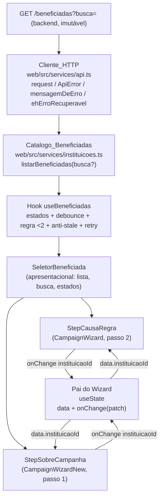

# Design Document

## Overview

Esta feature (T41) substitui os dados simulados de instituições/causas do wizard de campanha pelo catálogo real servido pelo backend em `GET /beneficiadas?busca=`. Hoje as duas variantes do wizard (`CampaignWizard` e `CampaignWizardNew`) consomem `instituicoesMock` e, no caso do `StepCausaRegra`, mantêm um pré-cadastro falso em estado local do componente. O design remove essa simulação, introduz uma camada de serviço tipada, um hook de busca de dados reutilizável e um componente de seleção compartilhado, de modo que ambos os passos ganhem o mesmo comportamento de carregamento, erro, vazio, busca e persistência de seleção.

Decisões centrais do design e sua rastreabilidade:

- Toda comunicação com o catálogo passa pelo `Cliente_HTTP` compartilhado (`web/src/services/api.ts`), que já envia `credentials: "include"`, prefixa `/api` e normaliza erros em `ApiError`. Nenhuma rota nova é inventada (Requisitos 1.1, 4.1).
- A lógica de estados (carregando/erro/vazio/carregado), debounce de 300 ms, regra de 2 caracteres e proteção contra respostas obsoletas fica encapsulada em um único hook (`useBeneficiadas`), evitando duplicação entre os dois passos (Requisitos 1, 2, 3).
- A interface de seleção (lista, campo de busca e os três estados) é extraída para um componente apresentacional reutilizável (`SeletorBeneficiada`), consumido tanto por `StepCausaRegra` quanto por `StepSobreCampanha` (Requisitos 1, 2, 3, 5).
- A seleção é persistida apenas via estado do wizard no componente pai, que já sobrevive à navegação entre passos; o passo nunca guarda o `id` selecionado em estado próprio (Requisito 5).
- O pré-cadastro falso é removido. A afordância "Cadastrar nova instituição" passa a um estado desabilitado / "em breve" que nunca chama rota não confirmada e preserva a seleção e os dados preenchidos (Requisito 8).
- Os dados simulados são removidos por completo após a migração: `mock-data.ts` é apagado e `types.ts` passa a refletir o formato real (Requisito 7).

### Escopo

Dentro do escopo: `web/src/services/instituicoes.ts` (novo), `web/src/services/api.ts` (apenas consumo, sem alteração), `web/src/lib/campaign-wizard/types.ts`, `web/src/lib/campaign-wizard/mock-data.ts` (remoção), `StepCausaRegra.tsx`, `StepSobreCampanha.tsx`, `CampaignWizard.tsx`, `CampaignWizardNew.tsx`, mais o novo hook e o novo componente de seleção.

Fora do escopo: o endpoint de pré-cadastro (inexistente no backend), `mockEmpresaAtual` e `SealPreviewPanel` (seguem como estão), e qualquer alteração no contrato de `GET /beneficiadas`.

## Architecture

A integração segue uma separação em três camadas, alinhada à convenção já existente no projeto (serviços por recurso importando `request` de `./api`):



Responsabilidades por camada:

1. **Camada de serviço (`instituicoes.ts`)**: traduz a chamada HTTP em uma função tipada `listarBeneficiadas(busca?)`, monta a query string, aplica o descarte de itens sem `id`/`nome` e devolve um array `Beneficiada[]`. É stateless e não conhece React (Requisitos 1.1, 1.7, 1.8, 3.1, 3.2).
2. **Camada de estado (`useBeneficiadas`)**: hook React que orquestra a máquina de estados, o debounce de 300 ms, a regra de 2 caracteres, o cancelamento/descarte de respostas obsoletas e a nova tentativa (Requisitos 1.2–1.5, 2, 3.3, 3.6, 3.7, 4.10).
3. **Camada de apresentação (`SeletorBeneficiada` + passos)**: renderiza a lista, o campo de busca e os estados carregando/erro/vazio; delega a seleção ao `onChange` do pai (Requisitos 1.2, 1.3, 1.4, 1.6, 2.1–2.7, 5.1–5.3).

A persistência da seleção não é uma camada nova: ela reusa o estado `data` que o pai do wizard já mantém em `useState` e que não é reinicializado ao navegar entre passos (Requisito 5.4).

### Justificativa: extrair o componente `SeletorBeneficiada`

A extração é recomendada e adotada. Ambos os passos precisam ganhar comportamento idêntico de carregamento, erro, vazio, busca (debounce + regra de 2 caracteres) e persistência de seleção. Sem extração, essa lógica visual seria duplicada em dois arquivos com divergência inevitável ao longo do tempo. As diferenças entre os passos são apenas de layout de contorno (`StepCausaRegra` usa uma pilha vertical com chip; `StepSobreCampanha` usa cards em linha com avatar), o que é resolvido por props de variação visual, mantendo a lógica única. O hook `useBeneficiadas` carrega a lógica de dados; o `SeletorBeneficiada` carrega a UI de lista/busca/estados.

## Components and Interfaces

### Serviço — `web/src/services/instituicoes.ts` (novo)

Segue exatamente a convenção de `empresas.ts`/`auth.ts` (importa `request` de `./api`, exporta tipos e funções do recurso).

```ts
import { request } from "./api";

export type TipoBeneficiada = "INSTITUICAO" | "CAUSA";

export type Beneficiada = {
  tipo: TipoBeneficiada;
  id: string;
  nome: string;
  causa: string | null;
  cidade: string | null;
  uf: string | null;
  descricao: string;
  site: string | null;
  logoArquivoId: string | null;
};

// Lista o catálogo real. Sem `busca` ou com termo < 2 caracteres, não envia
// filtro (catálogo completo). Descarta itens sem `id` ou `nome` (Req 1.8).
export function listarBeneficiadas(busca?: string): Promise<Beneficiada[]>;
```

Regras de implementação do serviço:

- Monta o path como `/beneficiadas` e acrescenta `?busca=<termo>` apenas quando `busca` tem 2 ou mais caracteres (após `trim`); abaixo disso, chama `/beneficiadas` sem o parâmetro (Requisitos 3.1, 3.2).
- O termo é codificado com `encodeURIComponent` para evitar query string malformada.
- Chama `request<Beneficiada[]>(path)` — o `request` já aplica `credentials: "include"` e prefixo `/api`; erros chegam como `ApiError` e são propagados sem tratamento aqui (Requisito 4.1).
- Filtra o array retornado removendo itens cujo `id` ou `nome` sejam ausentes/vazios antes de devolver (Requisito 1.8).

### Hook — `useBeneficiadas`

Encapsula a máquina de estados, a busca com debounce e a proteção anti-stale. Fica em `web/src/components/campaign-wizard/` (ou em um `hooks/` dentro desse diretório), próximo de quem o consome.

```ts
export type EstadoBeneficiadas = "carregando" | "erro" | "vazio" | "carregado";

export type UseBeneficiadasResultado = {
  estado: EstadoBeneficiadas;
  beneficiadas: Beneficiada[];   // relevante em "carregado"
  termoBusca: string;
  mensagemErro: string;          // relevante em "erro"
  podeTentarNovamente: boolean;  // true só quando ehErroRecuperavel
  definirTermoBusca: (termo: string) => void;
  tentarNovamente: () => void;
};

export function useBeneficiadas(): UseBeneficiadasResultado;
```

Comportamento do hook:

- Dispara a busca inicial na montagem (catálogo completo) e refaz a busca sempre que o termo (debounced) muda (Requisitos 1.1, 3.1–3.3).
- Aplica debounce de 300 ms sobre as alterações de termo antes de chamar o serviço (Requisito 3.3).
- Guarda um identificador monotônico (sequência) por requisição; ao receber uma resposta, só a aplica se for a mais recente. Respostas de termos antigos são descartadas (anti-stale). O mesmo mecanismo serve ao cancelamento lógico quando um `AbortController` é usado (Requisitos 3.3, 5.5).
- Mapeia erros com `mensagemDeErro(erro)` e decide a ação de nova tentativa com `ehErroRecuperavel(erro)` (Requisitos 2.4, 2.5, 2.6, 4.4–4.9).
- Preserva a lista previamente carregada no estado de erro, sem substituí-la por dados parciais (Requisitos 2.4, 5.6, 7.3).
- `tentarNovamente()` reemite a última requisição e volta ao estado `carregando` (Requisitos 2.7, 4.10).

### Componente apresentacional — `SeletorBeneficiada`

```ts
export type SeletorBeneficiadaProps = {
  beneficiadas: Beneficiada[];
  estado: EstadoBeneficiadas;
  termoBusca: string;
  mensagemErro: string;
  podeTentarNovamente: boolean;
  selecionadaId: string | null;         // = data.instituicaoId
  onBuscar: (termo: string) => void;     // = definirTermoBusca
  onTentarNovamente: () => void;         // = tentarNovamente
  onSelecionar: (id: string) => void;    // chama onChange({ instituicaoId: id })
  variante?: "lista" | "cards";          // layout: StepCausaRegra vs StepSobreCampanha
};
```

Responsabilidades:

- Renderiza o campo de busca ligado a `onBuscar` (Requisito 3).
- Em `carregando`, exibe o indicador como único estado e bloqueia a seleção (Requisitos 1.2, 2.1, 4.2).
- Em `vazio`, exibe "Nenhuma instituição disponível no momento" (catálogo) ou a variante de "nenhum resultado para o termo" quando há busca ativa (Requisitos 2.3, 3.5).
- Em `erro`, exibe `mensagemErro` e a ação "Tentar novamente" apenas quando `podeTentarNovamente` é verdadeiro (Requisitos 2.4–2.6, 4.7, 4.8).
- Em `carregado`, renderiza a lista na ordem recebida, com nome e descrição por item, marcando como selecionada a beneficiada cujo `id` coincide com `selecionadaId`; quando nenhum item coincide, nada é marcado (Requisitos 1.3, 1.6, 5.2, 5.3).
- A afordância de pré-cadastro é renderizada em estado desabilitado/"em breve" (ver Error Handling / seção de pré-cadastro).

### Passos — `StepCausaRegra` e `StepSobreCampanha`

Ambos deixam de importar `instituicoesMock`. Cada passo chama `useBeneficiadas()` e repassa o resultado a `<SeletorBeneficiada .../>`, fornecendo `selecionadaId={data.instituicaoId}` e `onSelecionar={(id) => onChange({ instituicaoId: id })}`. `StepCausaRegra` mantém o bloco de "Regra da doação" como está; `StepSobreCampanha` mantém os campos de nome/descrição e a regra inline. Nenhum passo mantém estado local de seleção (Requisitos 5.1, 5.4, 7.1, 7.4, 7.5).

### Pais do wizard — `CampaignWizard` e `CampaignWizardNew`

Permanecem praticamente inalterados: continuam guardando `data` em `useState<CampaignWizardData>` e repassando `data`/`patch`. As validações de passo já existentes (`data.instituicaoId !== null`) continuam bloqueando o avanço quando não há seleção (Requisitos 6.1, 6.2). A única limpeza necessária é garantir que nenhum deles referencie mock.

## Data Models

### Tipo `Beneficiada`

Vive em `web/src/services/instituicoes.ts` como fonte canônica do formato de API e é reexportado por `web/src/lib/campaign-wizard/types.ts` para consumo do wizard. Representa tanto `INSTITUICAO` quanto `CAUSA`, distinguidas pelo campo `tipo` (Requisitos 1.7, 7.7).

| Campo          | Tipo                          | Observação                                  |
|----------------|-------------------------------|---------------------------------------------|
| `tipo`         | `"INSTITUICAO" \| "CAUSA"`    | distingue instituição de causa              |
| `id`           | `string`                      | obrigatório; item sem `id` é descartado     |
| `nome`         | `string`                      | obrigatório; item sem `nome` é descartado   |
| `causa`        | `string \| null`              | nullable                                    |
| `cidade`       | `string \| null`              | nullable                                    |
| `uf`           | `string \| null`              | nullable                                    |
| `descricao`    | `string`                      | exibida no card                             |
| `site`         | `string \| null`              | nullable                                    |
| `logoArquivoId`| `string \| null`              | nullable                                    |

### Reconciliação de `Instituicao` em `types.ts`

O tipo plano atual `Instituicao = { id, nome, cidade, descricao }` não reflete o contrato (Requisito 7.7). Ele é substituído: `types.ts` passa a reexportar `Beneficiada` (de `instituicoes.ts`) e, para compatibilidade mínima enquanto os passos migram, `Instituicao` é definido como alias de `Beneficiada` ou removido se nenhum módulo mais o referenciar. `CampaignWizardData.instituicaoId` permanece `string | null` e `initialWizardData.instituicaoId` permanece `null` (Requisitos 5.1, 6.1, 6.2). `mockEmpresaAtual` permanece intocado (fora de escopo).

### Modelo de query

- Catálogo completo: `GET /beneficiadas` (sem parâmetro) — usado na montagem e quando o termo tem menos de 2 caracteres (Requisito 3.2).
- Busca: `GET /beneficiadas?busca=<termo>` — usado quando o termo (após `trim`) tem de 2 a 200 caracteres (Requisito 3.1).

## Correctness Properties

*Uma propriedade é uma característica ou comportamento que deve valer para todas as execuções válidas do sistema — essencialmente, uma afirmação formal sobre o que o sistema deve fazer. Propriedades servem de ponte entre a especificação legível por humanos e garantias de correção verificáveis por máquina.*

A lógica pura desta feature (montagem de query no serviço, descarte de itens inválidos, proteção anti-stale no hook, marcação de seleção e preservação de estado) é adequada para teste baseado em propriedades. Já a aparência dos estados (textos fixos, layout, timers de 300 ms/30 s) é coberta por testes de exemplo/edge no Testing Strategy.

### Property 1: Descarte de beneficiadas sem id ou nome

*Para qualquer* lista bruta retornada pelo endpoint `GET /beneficiadas`, `listarBeneficiadas` deve expor exatamente os itens cujos campos `id` e `nome` são não vazios, preservando sua ordem relativa e descartando todos os demais.

**Validates: Requirements 1.8**

### Property 2: Itens renderizados correspondem à lista recebida, na ordem

*Para qualquer* lista de beneficiadas fornecida ao `SeletorBeneficiada`, a sequência de itens renderizados deve ser exatamente igual à sequência recebida, sem acréscimos, remoções ou reordenações.

**Validates: Requirements 1.3, 3.4**

### Property 3: Nome e descrição presentes em cada item

*Para qualquer* lista de beneficiadas renderizada, cada item exibido deve conter o `nome` e a `descricao` da beneficiada correspondente.

**Validates: Requirements 1.6**

### Property 4: Regra de busca por comprimento do termo

*Para qualquer* termo de busca, `listarBeneficiadas` deve incluir o parâmetro `busca=<termo>` na requisição se e somente se o termo (após `trim`) tiver 2 ou mais caracteres; abaixo disso, a requisição não deve conter valor de filtro no parâmetro `busca`.

**Validates: Requirements 3.1, 3.2**

### Property 5: Resposta obsoleta nunca sobrescreve a mais recente

*Para qualquer* sequência de alterações de termo de busca que gere respostas que chegam fora de ordem, o estado final exibido pelo hook deve corresponder sempre à resposta da requisição mais recente, nunca a uma resposta de um termo anterior.

**Validates: Requirements 3.3, 5.5**

### Property 6: Ação de nova tentativa condicionada ao tipo de erro

*Para qualquer* erro retornado pelo Cliente_HTTP, o `SeletorBeneficiada` deve exibir a ação "Tentar novamente" se e somente se `ehErroRecuperavel` for verdadeiro para aquele erro.

**Validates: Requirements 2.6, 4.8, 4.9**

### Property 7: Preservação da lista anterior sob falha

*Para qualquer* lista previamente carregada, se uma requisição subsequente falhar, a lista exibida deve permanecer igual à anterior, sem substituição por dados parciais e sem recorrer a dados simulados.

**Validates: Requirements 2.4, 7.3**

### Property 8: Preservação do termo de busca sob falha

*Para qualquer* termo de busca digitado, se a requisição correspondente falhar, o termo exibido no campo de busca deve permanecer igual ao digitado.

**Validates: Requirements 3.7**

### Property 9: Registro da seleção via onChange

*Para qualquer* beneficiada exibida, ao selecioná-la o passo deve invocar `onChange` com `instituicaoId` igual ao `id` daquela beneficiada.

**Validates: Requirements 5.1**

### Property 10: Marcação de seleção reflete o identificador

*Para qualquer* lista de beneficiadas e qualquer `instituicaoId`, se o `id` corresponder a exatamente uma beneficiada exibida, somente essa beneficiada deve aparecer como selecionada; se o `id` não corresponder a nenhuma, nenhuma beneficiada deve aparecer selecionada e o `instituicaoId` deve permanecer inalterado.

**Validates: Requirements 5.2, 5.3**

### Property 11: Persistência do identificador na navegação

*Para qualquer* `instituicaoId` selecionado, navegar do Passo_Beneficiada para outro passo e retornar deve preservar o valor de `instituicaoId` no estado do wizard.

**Validates: Requirements 5.4**

### Property 12: Preservação do identificador no payload

*Para qualquer* `instituicaoId` não nulo e não vazio selecionado, a conclusão do wizard deve incluir no Payload_Criacao_Campanha exatamente esse mesmo identificador.

**Validates: Requirements 6.1, 6.3**

### Property 13: Bloqueio de avanço sem seleção

*Para qualquer* estado do wizard em que `instituicaoId` seja nulo ou vazio, a validação do Passo_Beneficiada deve impedir o avanço.

**Validates: Requirements 6.2, 6.4**

### Property 14: Pré-cadastro não fabrica beneficiadas locais

*Para qualquer* interação com a afordância de pré-cadastro enquanto o endpoint não existe, a lista de beneficiadas exibida não deve ganhar itens fabricados e a seleção e os dados preenchidos devem permanecer inalterados.

**Validates: Requirements 8.1, 8.3**

### Property 15: Pré-cadastro não emite requisição de rede

*Para qualquer* interação com a afordância de pré-cadastro no estado atual (sem endpoint confirmado), nenhuma requisição de rede deve ser emitida a qualquer rota.

**Validates: Requirements 8.6**

## Error Handling

O tratamento de erro reusa integralmente os utilitários do Cliente_HTTP, sem reimplementar mapeamento de status.

### Fonte e normalização

- Toda falha de rede chega como `ApiError` lançado por `request` (status 0 para falha de conexão; `res.status` para respostas não-ok). O serviço propaga sem capturar; o hook captura e traduz (Requisito 4.1).
- A mensagem exibida vem de `mensagemDeErro(erro)` (Requisitos 2.4, 4.4, 4.5, 4.6). Quando ela vier vazia/ausente, o hook aplica uma mensagem padrão de "falha ao carregar as instituições" (Requisitos 2.5, 4.7).
- A visibilidade da ação "Tentar novamente" é decidida por `ehErroRecuperavel(erro)` — verdadeiro para status 0 e >= 500 (Requisitos 2.6, 4.8, 4.9).

### Mapeamento por status

| Status | Mensagem (via `mensagemDeErro`)                         | "Tentar novamente" | Requisitos  |
|--------|---------------------------------------------------------|--------------------|-------------|
| 0      | mensagem de falha de conexão do `ApiError`              | sim                | 2.6, 4.9    |
| 401    | "Sua sessão expirou. Entre novamente para continuar."   | não                | 4.4         |
| 403    | "Você não tem permissão para acessar este conteúdo."    | não                | 4.5         |
| 404    | "Não encontramos o que você procurava."                 | não                | 4.6         |
| >= 500 | "O servidor está indisponível no momento..."            | sim                | 4.8         |
| 401/403/404 sem mensagem | mensagem genérica padrão do passo     | sim (recarga)      | 4.7         |

Observação sobre o Requisito 4.7: para 401/403/404 sem mensagem, o passo exibe o Estado_Erro genérico com ação de recarga. Essa ação é uma recarga da lista (não o botão de "recuperável"), de modo a não conflitar com a regra geral de `ehErroRecuperavel` dos Requisitos 2.6/4.8.

### Preservação de estado sob erro

- A lista previamente carregada não é descartada em caso de falha subsequente (Requisitos 2.4, 5.6, 7.3).
- O termo de busca digitado é preservado quando a busca falha (Requisito 3.7).
- O `instituicaoId` selecionado é preservado quando a recarga ao voltar falha (Requisitos 5.6, 8.3).

### Timeouts

- O timeout de 30 s (Requisitos 2.2, 4.1, 4.9) e o limite de 10 s por busca (Requisitos 1.5, 3.7) são tratados pelo hook, que encerra o Estado_Carregamento e transiciona para Estado_Erro ao expirar, reusando o mesmo caminho de erro acima.

### Pré-cadastro (Requisito 8)

- O fluxo falso de `StepCausaRegra` (estado local `extraInstituicoes`, formulário que fabrica `custom-${Date.now()}` e chip "Pendente de aprovação") é removido (Requisitos 8.1, 7.3).
- A afordância "Cadastrar nova instituição" permanece visível, porém em estado desabilitado / "em breve": ao ser acionada, exibe em até 1 s a mensagem de que o pré-cadastro ainda não está disponível e não altera a seleção nem dados preenchidos (Requisitos 8.2, 8.3).
- Nenhuma requisição é emitida a qualquer rota de pré-cadastro: não há POST, pois o endpoint não existe no backend. O caminho real fica atrás de um flag/guarda a ser ligado somente quando o contrato existir (Requisitos 8.4, 8.5, 8.6).

## Testing Strategy

O projeto já usa Vitest + fast-check (ver `web/tests/unit`, `web/tests/component`, `web/tests/integration`) com os helpers `instalarMockFetch`, `requestContract` e `servicoExiste`, conforme a spec `testes-frontend`. Este design segue essas convenções: o `request` real é exercitado contra um fetch mockado (nunca rede de verdade), e o teste condicional existente `instituicoes-campanhas.conditional.test.ts` passará a rodar assim que `instituicoes.ts` existir, devendo ser ajustado para afirmar `listarBeneficiadas`.

### Abordagem dupla

- **Testes de unidade (exemplos e edge cases)**: caminhos concretos e mensagens fixas — caminho feliz 200, lista vazia com texto exato, mapeamento 401/403/404/5xx/0, debounce de 300 ms e timeouts de 10 s/30 s (com fake timers), e verificações estruturais de remoção do mock.
- **Testes de propriedade (fast-check, mínimo 100 iterações cada)**: as 15 propriedades da seção Correctness Properties, uma propriedade por teste.

### Testes do serviço (`instituicoes.ts`) — com `request`/fetch mockado

- Propriedade 1 (descarte de itens sem `id`/`nome`) e Propriedade 4 (regra de busca por comprimento do termo), gerando listas e termos aleatórios.
- Exemplos: preservação de todos os campos do contrato (1.7), caminho 200, propagação de `ApiError` em falha.

### Testes do hook (`useBeneficiadas`) — com fetch mockado e fake timers

- Propriedade 5 (anti-stale), Propriedade 6 (botão sse recuperável), Propriedade 7 (preservação da lista anterior), Propriedade 8 (preservação do termo).
- Exemplos/edge: debounce de 300 ms (3.3), timeout de 30 s (2.2) e 10 s (1.5/3.7), mensagem padrão quando `mensagemDeErro` vazia (2.5/4.7), disparo na montagem (1.1).

### Testes de componente (`SeletorBeneficiada` e passos)

- Propriedade 2 (ordem/itens renderizados), Propriedade 3 (nome+descrição por item), Propriedade 9 (registro da seleção), Propriedade 10 (marcação reflete o id), Propriedade 14 (pré-cadastro não fabrica itens), Propriedade 15 (pré-cadastro não emite rede — espionando fetch).
- Exemplos: estado carregando como único visível e seleção bloqueada (1.2/2.1), vazio do catálogo com texto exato (2.3), vazio de busca (3.5), mensagens 401/403/404 (4.4–4.6), ação "Tentar novamente" refaz requisição (2.7/4.10), mensagem de pré-cadastro indisponível (8.2).

### Testes de integração do wizard (persistência e payload)

- Propriedade 11 (persistência do id na navegação), Propriedade 12 (id no payload final), Propriedade 13 (bloqueio de avanço sem seleção), exercitados em `CampaignWizard` (passo 2) e `CampaignWizardNew` (passo 1).
- Exemplos: voltar ao passo marca a seleção após recarga (5.5), falha de recarga preserva id + mostra erro (5.6).

### Verificações estruturais (remoção do mock)

- Afirmar ausência de import de `instituicoesMock` em `StepCausaRegra` e `StepSobreCampanha` (7.4, 7.5), ausência do arquivo `mock-data.ts` e de qualquer referência a `instituicoesMock` no projeto (7.6), e que `Instituicao` reflete o formato de `Beneficiada` (7.7).

### Configuração dos testes de propriedade

- Cada teste de propriedade usa fast-check com no mínimo 100 iterações.
- Cada teste é anotado com um comentário referenciando a propriedade do design, no formato: **Feature: catalogo-instituicoes-wizard, Property {número}: {texto da propriedade}**.
- Cada propriedade de correção é implementada por um único teste de propriedade.
