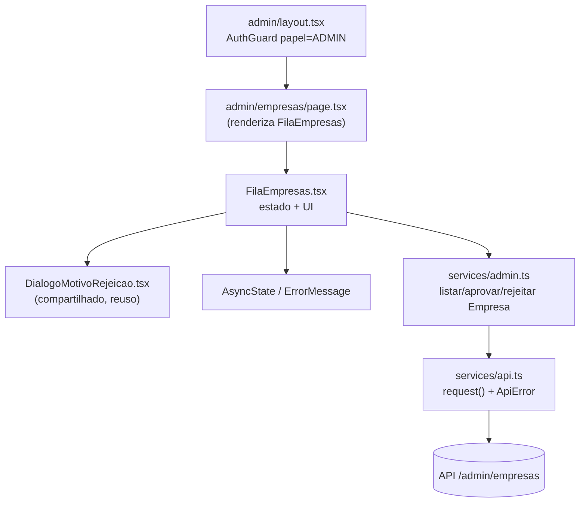

# Design Document

## Overview

Esta funcionalidade adiciona ao painel administrativo a fila de **empresas pendentes** de análise, com as ações de **aprovar** (com confirmação) e **rejeitar** (informando um motivo de no mínimo 20 caracteres). O fluxo espelha fielmente o das instituições (F6/F7), porém **sem documento de validação**: não há botão "Ver documento", nem `verDocumento()`, nem os campos `documentoDisponivel`/`documentoArquivoId`, nem o aviso de `cnpjCoincideComEmpresa`, nem o `Chip` de `causa`, nem `cidade`/`uf`. Cada linha de empresa exibe apenas **razão social, CNPJ, e-mail e data do cadastro**.

A estratégia de projeto é **reaproveitamento máximo** do que já está provado:

- O componente `FilaEmpresas` reusa a mesma máquina de estados e os mesmos helpers de `FilaInstituicoes` (`carregar`, `decidir`, tratamento de 401/403/404/409, remoção otimista e `Snackbar` de aviso), removendo tudo que é específico de documento.
- O serviço `admin.ts` ganha as funções `listarFilaEmpresas`, `aprovarEmpresa` e `rejeitarEmpresa`, espelhando as de instituição.
- O diálogo de motivo **já existe e é genérico** (`DialogoMotivoRejeicao`), construído para instituições e empresas, e já aplica o mínimo de 20 caracteres no cliente via `MOTIVO_REJEICAO_MINIMO`. Será reusado **sem alteração**.
- A rota `/admin/empresas` já está sob o `AuthGuard` com papel `ADMIN` pelo layout administrativo; a página apenas passa a renderizar `<FilaEmpresas />`.

### Requisitos atendidos

| Requisito | Onde é atendido |
| --- | --- |
| 1. Serviço de listagem | `listarFilaEmpresas` + tipo `ItemFilaEmpresa` em `admin.ts` |
| 2. Serviço de aprovação | `aprovarEmpresa` em `admin.ts` |
| 3. Serviço de rejeição | `rejeitarEmpresa` em `admin.ts` |
| 4. Proteção de rota | `AuthGuard papel="ADMIN"` herdado do layout + redirecionamento 401 na `FilaEmpresas` |
| 5. Exibição da lista | `FilaEmpresas` + `AsyncState` |
| 6. Erro no carregamento | `AsyncState` com `onRetry` |
| 7. Aprovação com confirmação | `Dialog` de confirmação na `FilaEmpresas` |
| 8. Rejeição com motivo | `DialogoMotivoRejeicao` reusado |
| 9. Erros de decisão | helper `decidir` + `mensagemDeErro` com mensagens por status |

## Architecture

A arquitetura segue a separação já adotada no projeto: **página (rota) → componente de fila (estado/UI) → serviço (HTTP) → cliente genérico `request`**. A proteção por papel vem do layout acima da página.



### Decisões de projeto

- **Reuso do `DialogoMotivoRejeicao` sem alteração.** O componente já é genérico (recebe `titulo`, `descricao`, `enviando`, `erro`, `onCancelar`, `onConfirmar`) e já valida o mínimo de caracteres no cliente. Criar uma variante para empresas só duplicaria código. A `FilaEmpresas` apenas injeta o texto e os handlers.
- **Remoção otimista com recarga em caso de conflito.** Ao decidir, a empresa é removida da lista imediatamente (bom feedback). Se a API responde 409/404, o estado local estava defasado: fechamos o diálogo, avisamos e recarregamos — igual ao F6.
- **Nenhuma lógica de documento.** Como empresas não têm documento de validação, todo o caminho de `verDocumento`, `baixarArquivo`, `VALIDADE_URL_DOCUMENTO_MS` e os alertas de documento/CNPJ coincidente são omitidos. Isso simplifica o componente em relação a `FilaInstituicoes`.
- **Mensagens por status reaproveitando `mensagemDeErro`.** Um mapa `MENSAGENS_DECISAO` cobre 403 (sem permissão) e 422 (motivo inválido); os demais caem nas mensagens padrão de `api.ts`.

## Components and Interfaces

### Servico_Admin — `web/src/services/admin.ts` (acréscimos)

Mantém a constante já exportada `MOTIVO_REJEICAO_MINIMO = 20` (reusada pelo diálogo). Acrescenta o tipo e as três funções de empresa, espelhando as de instituição:

```typescript
export type ItemFilaEmpresa = {
  id: string;
  razaoSocial: string;
  cnpj: string;
  email: string;
  criadoEm: string;
};

export function listarFilaEmpresas(): Promise<ItemFilaEmpresa[]> {
  return request("/admin/empresas");
}

export function aprovarEmpresa(id: string): Promise<void> {
  return request(`/admin/empresas/${id}/aprovacao`, { method: "POST" });
}

export function rejeitarEmpresa(id: string, motivo: string): Promise<void> {
  return request(`/admin/empresas/${id}/rejeicao`, {
    method: "POST",
    headers: { "Content-Type": "application/json" },
    body: JSON.stringify({ motivo }),
  });
}
```

Observações:
- `listarFilaEmpresas` retorna a lista **na ordem recebida da API** (sem reordenar). _(R1.3, R5.4)_
- `aprovarEmpresa`/`rejeitarEmpresa` resolvem sem conteúdo (a API responde 204). _(R2.2, R3.2)_

### Fila_Empresas — `web/src/components/admin/FilaEmpresas.tsx` (novo)

Componente cliente (`"use client"`) que replica a máquina de estados de `FilaInstituicoes`, sem nada de documento.

Estado:

| Estado | Tipo | Papel |
| --- | --- | --- |
| `itens` | `ItemFilaEmpresa[]` | lista exibida |
| `carregando` | `boolean` | controla o indicador de carregamento |
| `erro` | `unknown` | erro do carregamento da lista |
| `decisao` | `"aprovacao" \| "rejeicao" \| null` | qual diálogo está aberto |
| `selecionada` | `ItemFilaEmpresa \| null` | empresa alvo da decisão (persiste durante a animação de saída) |
| `enviando` | `boolean` | trava ações enquanto a decisão está em andamento |
| `erroDecisao` | `unknown` | erro da última tentativa de decisão |
| `aviso` | `{ severidade: AlertColor; mensagem: string } \| null` | `Snackbar` de sucesso/aviso |

Funções principais (mesma forma do F6):

- `carregar()` — `useCallback` que chama `listarFilaEmpresas`; dispara no `useEffect` inicial. Em `ApiError` 401 → `router.replace(APP_ROUTES.public.login)`; outros erros → `setErro`. _(R4.3, R5.1, R6.1)_
- `tentarNovamente()` — volta `carregando` para `true` e rechama `carregar`. _(R6.2)_
- `abrirDecisao(tipo, item)` / `fecharDecisao()` — abrem/fecham o diálogo correspondente; `fecharDecisao` não fecha enquanto `enviando`. _(R7.1, R7.6, R8.1)_
- `decidir(enviar, mensagemSucesso)` — executa `enviar()`, remove a empresa da lista por filtro (`setItens((atuais) => atuais.filter((i) => i.id !== item.id))`), fecha o diálogo e mostra `Snackbar` de sucesso. Em 401 → login; em 409/404 → fecha diálogo, aviso e `carregar()`; demais → `setErroDecisao`. _(R7.2–R7.5, R8.3, R8.5, R8.6, R9)_
- `aprovar()` — chama `decidir(() => aprovarEmpresa(id), "<razão social> foi aprovada.")`.
- `rejeitar(motivo)` — chama `decidir(() => rejeitarEmpresa(id, motivo), "<razão social> foi rejeitada. O motivo será enviado por e-mail.")`.

Renderização:

- `AsyncState` com `loading={carregando}`, `erro`, `vazio={itens.length === 0}`, `mensagemVazio="Nenhuma empresa aguardando análise."`, `onRetry={tentarNovamente}`. _(R5.2, R5.5, R6.1)_
- Lista (`Stack component="ul"`) de `Paper` por empresa, exibindo **razão social** (`h2`/`subtitle1`), **CNPJ** via `formatarCnpj`, **e-mail** e **data do cadastro** (`new Date(item.criadoEm).toLocaleDateString("pt-BR")`), na ordem recebida. _(R5.3, R5.4)_
- Ações por linha: botões **"Rejeitar"** (outlined/error) e **"Aprovar"** (contained), ambos desabilitados enquanto `enviando`. Sem botão de documento. _(R5.6)_
- `Dialog` de confirmação de aprovação, identificando `selecionada?.razaoSocial`, com ações desabilitadas enquanto `enviando`, e `ErrorMessage` quando `erroDecisao` existe (com `onRetry` só em erro recuperável). _(R7.1, R7.3, R9.3, R9.6)_
- `DialogoMotivoRejeicao` para rejeição (ver abaixo). _(R8.1–R8.4)_
- `Snackbar` + `Alert` para `aviso`. _(R7.5, R8.6, R9.1, R9.2)_

Mapa de mensagens de decisão:

```typescript
const MENSAGENS_DECISAO: Record<number, string> = {
  403: "Você não tem permissão para decidir sobre empresas.",
  422: "O motivo informado é inválido. Revise e tente novamente.",
};
```

### Dialogo_Motivo_Rejeicao — `web/src/components/admin/DialogoMotivoRejeicao.tsx` (reuso, sem alteração)

Componente compartilhado já existente. A `FilaEmpresas` o usa assim:

```tsx
<DialogoMotivoRejeicao
  open={decisao === "rejeicao"}
  titulo="Rejeitar empresa"
  descricao={<>Explique por que <strong>{selecionada?.razaoSocial}</strong> não foi aprovada. A empresa recebe este motivo por e-mail.</>}
  enviando={enviando}
  erro={erroDecisao !== null ? mensagemDeErro(erroDecisao, MENSAGENS_DECISAO) : null}
  onCancelar={fecharDecisao}
  onConfirmar={rejeitar}
/>
```

O componente já:
- valida o mínimo de `MOTIVO_REJEICAO_MINIMO` (20) caracteres após `trim`, impedindo o envio e exibindo a validação de tamanho; _(R8.2)_
- entrega a `onConfirmar` o motivo já sem espaços nas pontas; _(R8.3)_
- desabilita confirmar e cancelar enquanto `enviando`. _(R8.4)_

Nenhuma mudança é necessária nesse arquivo.

### Pagina_Empresas_Admin — `web/src/app/admin/empresas/page.tsx` (atualização)

A página stub passa a renderizar a fila:

```tsx
import FilaEmpresas from "@/components/admin/FilaEmpresas";

export default function AdminEmpresasPage() {
  return <FilaEmpresas />;
}
```

A proteção por papel é **herdada** de `web/src/app/admin/layout.tsx`, que já envolve o conteúdo em `<AuthGuard papel="ADMIN">`. Não é preciso repetir o guard na página. _(R4.1, R4.2)_

### Utilitários de apoio (sem alteração)

- `formatarCnpj` de `@/lib/mascaras` — formatação do CNPJ exibido.
- `ApiError`, `ehErroRecuperavel`, `mensagemDeErro` de `@/services/api` — tratamento e exibição de erros.
- `APP_ROUTES` de `@/lib/routes` — rota de login no redirecionamento 401.
- `AsyncState` e `ErrorMessage` de `@/components/ui` — estados de carregamento/erro/vazio.

## Data Models

### `ItemFilaEmpresa`

Empresa pendente aguardando decisão. É o modelo exibido na fila e o único payload da listagem.

| Campo | Tipo | Descrição |
| --- | --- | --- |
| `id` | `string` | identificador da empresa (usado nas rotas de decisão e no filtro de remoção) |
| `razaoSocial` | `string` | razão social exibida como título da linha |
| `cnpj` | `string` | CNPJ (formatado na exibição com `formatarCnpj`) |
| `email` | `string` | e-mail de contato exibido |
| `criadoEm` | `string` | data/hora do cadastro (ISO), exibida via `toLocaleDateString("pt-BR")` |

Diferença em relação a `ItemFilaInstituicao`: **ausência** de `causa`, `cidade`, `uf`, `documentoArquivoId`, `documentoDisponivel` e `cnpjCoincideComEmpresa`.

### Corpo da rejeição

A rejeição envia `{ "motivo": string }` em JSON para `/admin/empresas/{id}/rejeicao`. O `motivo` chega já com `trim` e com ao menos 20 caracteres (garantido pelo diálogo).

### Aviso (`Snackbar`)

Estado efêmero de UI: `{ severidade: "success" | "warning" | "error"; mensagem: string }`.

## Correctness Properties

*Uma propriedade é uma característica ou comportamento que deve valer para toda execução válida do sistema — essencialmente, uma afirmação formal sobre o que o sistema deve fazer. Propriedades servem de ponte entre a especificação legível por humanos e as garantias de correção verificáveis por máquina.*

As propriedades abaixo cobrem a lógica do nosso código que varia de forma significativa com a entrada (remoção otimista, validação de motivo e ordem/campos de renderização). Ramos de erro específicos, wiring de serviço e estados de UI pontuais são cobertos por testes de exemplo na estratégia de testes, não por propriedades.

### Property 1: Remoção otimista remove apenas a empresa decidida e preserva o restante

*Para toda* lista de empresas pendentes e *para qualquer* empresa dessa lista escolhida para decisão (aprovar ou rejeitar) concluída com sucesso, a lista resultante deve conter exatamente as demais empresas, na mesma ordem relativa, e não deve conter a empresa decidida.

**Validates: Requirements 7.4, 8.5**

### Property 2: Motivo abaixo do mínimo nunca é enviado

*Para toda* string cujo comprimento, após remover os espaços das extremidades, seja menor que `MOTIVO_REJEICAO_MINIMO` (20), ao tentar confirmar a rejeição o `DialogoMotivoRejeicao` não deve acionar `onConfirmar` (ou seja, `rejeitarEmpresa` nunca é chamada) e deve exibir a validação de tamanho mínimo.

**Validates: Requirements 8.2**

### Property 3: A fila renderiza as empresas na ordem recebida

*Para toda* lista de empresas pendentes retornada pela API, a `FilaEmpresas` deve renderizar as linhas na mesma ordem em que os itens aparecem na lista recebida.

**Validates: Requirements 5.4**

### Property 4: Cada linha exibe os dados essenciais da empresa

*Para toda* empresa pendente exibida, a linha correspondente deve conter a razão social, o CNPJ (formatado), o e-mail e a data do cadastro da empresa.

**Validates: Requirements 5.3**

## Error Handling

O tratamento de erros reusa `ApiError` e `mensagemDeErro`/`ehErroRecuperavel` de `@/services/api`, com um mapa `MENSAGENS_DECISAO` para os status específicos desta tela.

**Carregamento da lista (`carregar`)**

| Situação | Comportamento | Requisito |
| --- | --- | --- |
| `ApiError` 401 | `router.replace(APP_ROUTES.public.login)` | R4.3 |
| Qualquer outro erro | `setErro` → `AsyncState` mostra `ErrorMessage`; "Tentar novamente" só em erro recuperável (0 ou ≥500) | R6.1, R6.2 |

**Decisão (`decidir`, aprovação e rejeição)**

| Status | Comportamento | Requisito |
| --- | --- | --- |
| 401 | redireciona para login | R9.5 |
| 409 | fecha o diálogo, `Snackbar` "Outra pessoa já decidiu sobre {empresa}. A lista foi atualizada." e `carregar()` | R9.1 |
| 404 | fecha o diálogo, `Snackbar` "{empresa} não foi encontrada. A lista foi atualizada." e `carregar()` | R9.2 |
| 403 | `MENSAGENS_DECISAO[403]` ("Você não tem permissão para decidir sobre empresas.") no diálogo | R9.3 |
| 422 (rejeição) | `MENSAGENS_DECISAO[422]` ("O motivo informado é inválido...") no `DialogoMotivoRejeicao` | R9.4 |
| Demais (ex.: 500, 0) | `setErroDecisao` → `ErrorMessage` no diálogo em andamento; `onRetry` só em erro recuperável | R9.6 |

Notas:
- Em 409/404 recarregamos a lista porque o estado local estava defasado (a empresa já saiu da fila por outro caminho).
- O `DialogoMotivoRejeicao` já impede no cliente o envio de motivo curto, então o 422 é uma rede de segurança do servidor.
- Ao abrir/reenviar uma decisão, `erroDecisao` é zerado para não arrastar o erro anterior.

## Testing Strategy

O frontend já usa **Vitest + React Testing Library** (padrão do projeto em `web/`), com mocks de módulo de serviço (`vi.mock`) e `userEvent` para interações. Testes devem rodar em execução única (sem watch), por exemplo `vitest --run`.

### Testes de exemplo e integração (Vitest + RTL)

Serviço (`admin.ts`), com `request` mockado:
- `listarFilaEmpresas` faz GET em `/admin/empresas` e retorna a lista na ordem recebida. _(R1.2, R1.3)_
- `aprovarEmpresa(id)` faz POST em `/admin/empresas/{id}/aprovacao` e resolve sem conteúdo. _(R2.1, R2.2)_
- `rejeitarEmpresa(id, motivo)` faz POST em `/admin/empresas/{id}/rejeicao` com corpo `{motivo}` e resolve sem conteúdo. _(R3.1, R3.2)_

Componente (`FilaEmpresas`), com `admin.ts` e `next/navigation` mockados:
- fetch inicial e indicador de carregamento. _(R5.1, R5.2)_
- lista com botões Aprovar/Rejeitar por linha e estado vazio com "Nenhuma empresa aguardando análise". _(R5.5, R5.6)_
- erro no carregamento (≠401) mostra mensagem + "Tentar novamente", e o retry refaz a chamada. _(R6.1, R6.2)_
- 401 no carregamento redireciona para o login. _(R4.3)_
- aprovar: diálogo identifica a empresa, confirma chama `aprovarEmpresa(id)`, ações desabilitadas durante o envio, sucesso mostra `Snackbar`, cancelar não altera a lista. _(R7.1–R7.3, R7.5, R7.6)_
- rejeitar: abre o diálogo identificando a empresa; motivo válido chama `rejeitarEmpresa(id, motivo)`; ações desabilitadas durante o envio; sucesso mostra `Snackbar`. _(R8.1, R8.3, R8.4, R8.6)_
- erros de decisão: 409 e 404 fecham o diálogo, avisam e recarregam; 403 e 500 mostram mensagem no diálogo; 422 na rejeição mostra "motivo inválido"; 401 redireciona. _(R9.1–R9.6)_

Proteção de rota é herdada do `AuthGuard` no layout (já coberto pelos testes existentes do guard). _(R4.1, R4.2)_

### Testes de propriedade (fast-check)

Usar a biblioteca **fast-check** (padrão JS/TS para PBT); não implementar PBT do zero. Cada teste de propriedade roda **no mínimo 100 iterações** (`fc.assert(..., { numRuns: 100 })`) e é anotado com um comentário referenciando a propriedade de projeto.

- **Property 1 — remoção otimista.** Gerar uma lista aleatória de `ItemFilaEmpresa` (ids únicos) e um índice válido; simular a decisão bem-sucedida desse item e verificar que a lista resultante é a lista original sem aquele item, preservando a ordem relativa dos demais. Testa o filtro de `setItens` usado por `aprovar` e `rejeitar`.
  `// Feature: fila-empresas-pendentes-admin, Property 1: Remoção otimista remove apenas a empresa decidida e preserva o restante`
- **Property 2 — motivo curto nunca é enviado.** Gerar strings cujo comprimento após `trim` seja menor que 20 (incluindo vazias, só espaços e cauda de espaços); renderizar o `DialogoMotivoRejeicao`, preencher e submeter; verificar que `onConfirmar` nunca foi chamado e que a validação de mínimo aparece.
  `// Feature: fila-empresas-pendentes-admin, Property 2: Motivo abaixo do mínimo nunca é enviado`
- **Property 3 — ordem de renderização.** Gerar listas aleatórias; renderizar a `FilaEmpresas` com a lista mockada; verificar que a ordem das razões sociais no DOM é igual à ordem da lista de entrada.
  `// Feature: fila-empresas-pendentes-admin, Property 3: A fila renderiza as empresas na ordem recebida`
- **Property 4 — campos essenciais por linha.** Gerar `ItemFilaEmpresa` aleatório; renderizar; verificar que a linha contém a razão social, o CNPJ formatado (`formatarCnpj`), o e-mail e a data (`toLocaleDateString("pt-BR")`).
  `// Feature: fila-empresas-pendentes-admin, Property 4: Cada linha exibe os dados essenciais da empresa`

### Equilíbrio

Os testes de propriedade cobrem a correção geral (remoção, ordem, campos, validação) sobre muitos inputs; os testes de exemplo cobrem os ramos concretos de erro, o wiring do serviço e os estados pontuais de UI. Juntos dão cobertura completa dos requisitos sem duplicar esforço.
