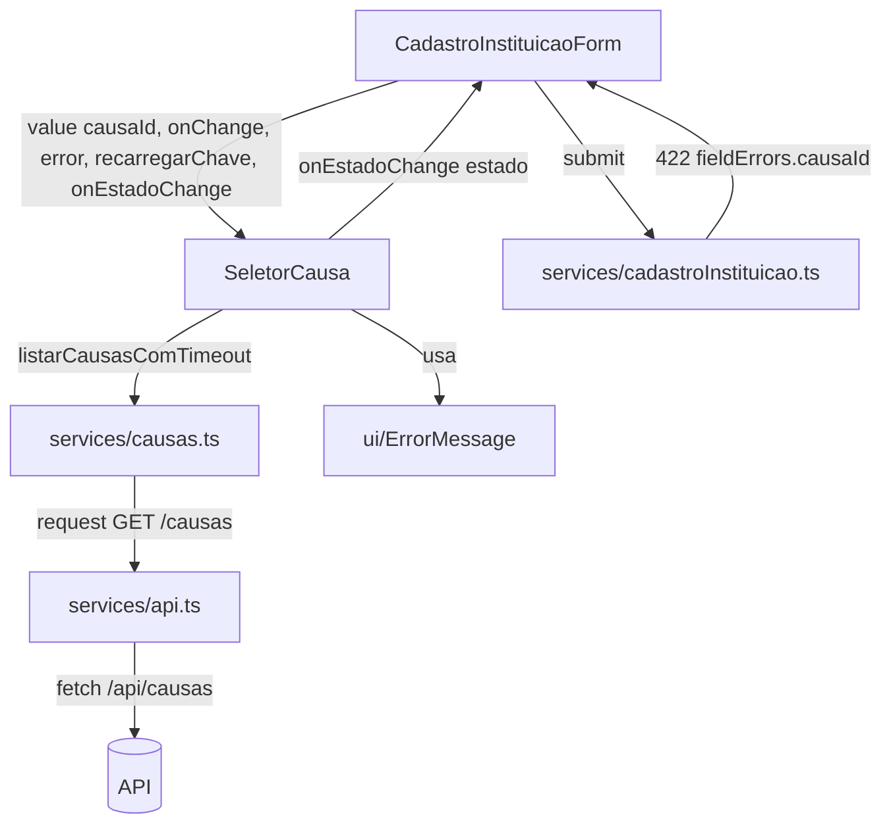
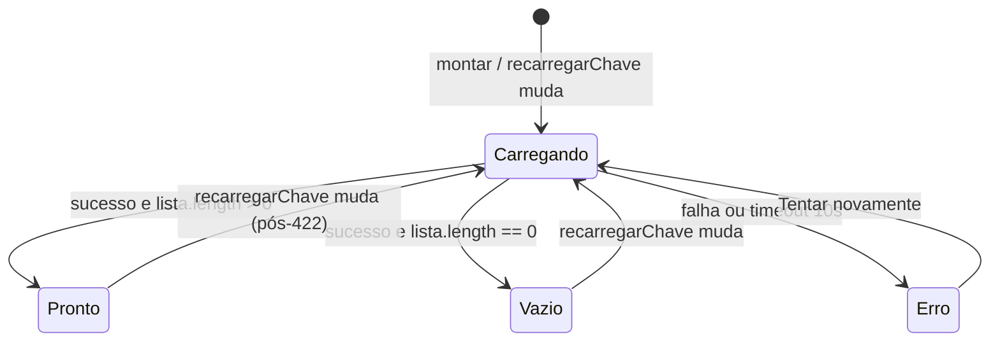

# Design Document

## Overview

A F2 substitui o campo provisório de causa por um seletor real, alimentado pela
rota pública `GET /causas`. O objetivo de design é fazê-lo **sem quebrar a
interface pública de `services/causas.ts`** (usada também pela F9) e **reusando
os blocos já existentes** do frontend: o cliente `request<T>` + `ApiError`, os
auxiliares `mensagemDeErro()`/`ehErroRecuperavel()` e o componente
`ErrorMessage`.

O componente `SeletorCausa` evolui de um `TextField select` provisório para um
seletor com quatro estados visuais explícitos — **carregando**, **erro** (com
"Tentar novamente"), **lista vazia** e **pronto** — e passa a exibir, por opção,
o `nome` e a `descricao` de cada causa. Além de renderizar, o seletor precisa
**reportar seu estado ao formulário** para que o botão "Enviar cadastro" seja
bloqueado enquanto não houver pelo menos uma causa carregada, e precisa aceitar
uma ordem de **recarregar** vinda do formulário para tratar a rejeição 422
"causa inválida ou inativa".

Decisões centrais (detalhadas adiante e justificadas em cada seção):

- **O `SeletorCausa` é o dono do seu próprio fetch.** Ele é a única parte da
  árvore que precisa das causas; centralizar o estado num hook do formulário
  (como no wizard `SeletorBeneficiada`) acoplaria o formulário ao ciclo de vida
  da lista sem ganho. O seletor expõe ao pai apenas o que o pai precisa saber:
  o estado de prontidão, via um callback `onEstadoChange`.
- **A prontidão é comunicada por um enum reportado via callback** (`onEstadoChange`),
  e o formulário deriva `podeEnviar` desse estado. É o contrato mais simples e
  alinhado ao React/MUI já praticado no projeto (props de dados + callbacks).
- **O recarregamento pós-422 é disparado por uma prop contadora
  `recarregarChave`** (reload key), não por `ref` imperativo. Incrementar um
  número no `useEffect` do seletor é a forma idiomática de "peça para refazer o
  efeito" sem expor API imperativa.
- **O Limite_De_Espera de 10 s é implementado com `AbortController` + timeout
  explícito**, convertido em erro recuperável para reusar o fluxo de
  "Tentar novamente".

## Architecture



Camadas e responsabilidades:

- **`services/api.ts`** (inalterado): `request<T>`, `ApiError` (com `.status` e
  `.fieldErrors`), `mensagemDeErro()`, `ehErroRecuperavel()`. Um 422 chega como
  `ApiError` com `fieldErrors.causaId` preenchido.
- **`services/causas.ts`** (API pública estável): continua expondo
  `listarCausas(): Promise<Causa[]>` e o tipo `Causa`. A F2 **adiciona** um
  auxiliar não-quebrador para o timeout (ver Components and Interfaces), sem
  alterar a assinatura existente.
- **`SeletorCausa`** (evolui): dono do fetch, da máquina de estados e da
  renderização dos quatro estados; reporta prontidão ao pai e aceita ordem de
  recarregar.
- **`CadastroInstituicaoForm`** (evolui): guarda `causaId`, deriva a habilitação
  do botão "Enviar" a partir do estado reportado pelo seletor, trata o 422
  (exibe mensagem no campo, limpa a seleção e manda recarregar).

### Máquina de estados do SeletorCausa



Apenas um estado está ativo por vez. O estado `Carregando` desabilita a seleção
e o botão de retry (evita requisições simultâneas — Requisito 4.6). `Erro` e
`Vazio` nunca mantêm causa selecionada válida.

## Components and Interfaces

### Tipo de estado reportado

```ts
// Em SeletorCausa.tsx (exportado para o formulário consumir)
export type EstadoSeletorCausa = "carregando" | "erro" | "vazio" | "pronto";
```

- `pronto` só ocorre quando a busca teve sucesso **e** retornou ao menos uma
  causa. É o único estado em que o formulário libera o envio.

### SeletorCausa — contrato de props

```ts
export type SeletorCausaProps = {
  value: string;                                   // = data.causaId
  onChange: (causaId: string) => void;             // grava causaId no formulário
  label: React.ReactNode;
  error?: string;                                   // erro de campo (ex.: 422/obrigatório)
  recarregarChave?: number;                         // reload key: incrementar força nova busca
  onEstadoChange?: (estado: EstadoSeletorCausa) => void; // reporta prontidão ao pai
};
```

Justificativa do contrato:

- **`onEstadoChange` (callback com enum) em vez de expor a lista ou flags soltas
  ao pai.** O formulário não precisa da lista de causas — precisa apenas saber
  "posso deixar enviar?". Um enum único evita múltiplos booleans
  correlacionados (`carregando`/`erro`/`vazio`) que poderiam ficar
  inconsistentes. É o mesmo espírito do `estado` de `SeletorBeneficiada`, porém
  aqui o estado nasce dentro do seletor e é **informado** ao pai.
- **`recarregarChave` (reload key numérica) em vez de `ref` imperativo.** No
  React idiomático, "refaça este efeito" se expressa adicionando um valor às
  dependências do `useEffect`. O formulário incrementa `recarregarChave` após o
  422; o seletor observa a mudança e reinicia a busca. Sem `useImperativeHandle`,
  sem `ref`, sem acoplamento de métodos.
- **`value`/`onChange`/`error` permanecem** exatamente como o formulário já usa
  hoje, minimizando a mudança no `CadastroInstituicaoForm`.

Comportamento interno:

- No montar e a cada mudança de `recarregarChave`, dispara a busca via
  `listarCausasComTimeout()` dentro de um `useEffect`, com `AbortController`.
- Mantém estado local: `estado: EstadoSeletorCausa` e `causas: Causa[]`.
- A cada transição de estado, chama `onEstadoChange(estado)` (dentro de um
  `useEffect` que observa `estado`, para evitar `setState`-durante-render no
  pai).
- Renderiza por estado:
  - **carregando**: `TextField select` desabilitado + indicador
    (`CircularProgress`/`helperText` "Carregando causas…"); seleção bloqueada.
  - **erro**: `ErrorMessage` com `mensagem` (de `mensagemDeErro()`) e `onRetry`
    que reinicia a busca; durante a nova busca o botão fica desabilitado.
  - **vazio**: mensagem exata **"Ainda não há causas cadastradas"**; seleção
    bloqueada.
  - **pronto**: `TextField select` habilitado; cada `MenuItem` exibe `nome` em
    destaque e `descricao` como texto secundário.

### listarCausasComTimeout — auxiliar não-quebrador no serviço

```ts
// services/causas.ts — ADIÇÃO. NÃO altera listarCausas() nem o tipo Causa.
export const LIMITE_ESPERA_CAUSAS_MS = 10_000;

export function listarCausasComTimeout(
  limiteMs = LIMITE_ESPERA_CAUSAS_MS,
): Promise<Causa[]> {
  const controller = new AbortController();
  const timer = setTimeout(() => controller.abort(), limiteMs);
  // request<T> aceita RequestInit; passamos o signal.
  return request<Causa[]>("/causas", { signal: controller.signal })
    .finally(() => clearTimeout(timer));
}
```

- **Preserva a API pública (Requisito 7):** `listarCausas()` e o tipo `Causa`
  continuam idênticos; a F9 não é afetada. O timeout é um auxiliar novo.
- **Aborto → erro recuperável:** quando o `AbortController` dispara, o `fetch`
  rejeita; `request()` converte isso em `ApiError(0, …)`, que
  `ehErroRecuperavel()` classifica como recuperável. Assim o Estado_Erro já
  recebe "Tentar novamente" sem lógica extra.
- **Decisão de simplicidade:** o timeout é tratado como **requisito funcional
  explícito** (e não apenas alvo não-funcional) porque o Requisito 1.7/3.4/4.1
  exigem transição para erro ao exceder 10 s. O `AbortController` é a forma
  padrão e mínima de garantir isso.

### CadastroInstituicaoForm — mudanças

- Novo estado local: `estadoCausa: EstadoSeletorCausa` e `recarregarCausas: number`.
- Deriva `causasProntas = estadoCausa === "pronto"`.
- Botão "Enviar cadastro": `disabled={loading || !causasProntas}` (Requisitos
  5.3, 5.4). Enquanto o seletor está carregando/erro/vazio, o envio fica
  bloqueado.
- `handleSubmit`/`validar`: além dos campos obrigatórios, bloqueia o envio se o
  seletor não estiver pronto; `causaId` vazio produz "Campo obrigatório"
  (já coberto por `CAMPOS_OBRIGATORIOS`).
- Tratamento do 422 em `enviar()`:
  1. No `catch`, se `e instanceof ApiError && e.status === 422 && e.fieldErrors.causaId`:
     - define `errosCampo.causaId = e.fieldErrors.causaId` (Mensagem_Causa_Invalida
       junto ao campo);
     - limpa a seleção: `patch("causaId", "")` (Requisito 6.3);
     - incrementa `recarregarCausas` para mandar o seletor recarregar
       (Requisito 6.2).
  2. O seletor recarrega; ao voltar a `pronto`, o usuário escolhe outra causa.
     Enquanto `causaId` estiver vazio, o envio segue bloqueado (Requisito 6.1).
  3. Se o recarregamento pós-422 falhar/estourar, o seletor cai em `erro` com
    "Tentar novamente"; `estadoCausa !== "pronto"` mantém o envio bloqueado
    (Requisito 6.4).

## Data Models

```ts
// services/causas.ts — INALTERADO (Requisito 7.1, 7.2)
export type Causa = {
  id: string;        // 1..36 caracteres
  nome: string;      // 1..120 caracteres
  descricao: string; // 0..500 caracteres
};
```

- `GET /causas` retorna **somente causas ativas**, em ordem alfabética
  (Requisitos 1.3, 1.4). O frontend **não** reordena nem filtra: renderiza na
  ordem recebida e confia que a lista já exclui inativas.
- A coleção tem de 0 a 500 itens; vazia é um resultado válido (Lista_Vazia,
  Requisito 7.4).
- `EstadoSeletorCausa` (enum de UI) é o único "modelo" novo, e vive no
  componente, não no serviço.

## Correctness Properties

*A property is a characteristic or behavior that should hold true across all valid executions of a system — essentially, a formal statement about what the system should do. Properties serve as the bridge between human-readable specifications and machine-verifiable correctness guarantees.*

### Property 1: Cada opção exibe nome e descrição

*Para qualquer* lista de causas retornada pelo serviço, no estado `pronto` cada
opção renderizada contém o `nome` e a `descricao` da causa correspondente.

**Validates: Requirements 1.2**

### Property 2: Renderização fiel à lista recebida (ordem e pertencimento)

*Para qualquer* lista de causas com `id`s únicos, a sequência de `id`s das
opções renderizadas é exatamente igual à sequência da lista recebida — mesma
ordem, sem acréscimos nem remoções. Em particular, nenhum `id` fora da lista
recebida aparece como opção (o front não exibe causas inativas/inexistentes).

**Validates: Requirements 1.3, 1.4**

### Property 3: Seleção emite o id correspondente

*Para qualquer* lista não vazia e *qualquer* causa escolhida nela, selecionar
essa causa chama `onChange` com exatamente o `id` dessa causa.

**Validates: Requirements 2.1**

### Property 4: Envio válido carrega um id pertencente à lista

*Para qualquer* lista não vazia e seleção do usuário, quando o envio ocorre o
`causaId` enviado a `criarInstituicao()` é igual ao `id` selecionado e pertence
à última lista carregada pelo seletor.

**Validates: Requirements 2.3**

### Property 5: Id fora da lista bloqueia o envio

*Para qualquer* lista e *qualquer* `causaId` que não corresponda a nenhuma causa
dessa lista, o envio ao servidor é impedido localmente e a Mensagem_Causa_Invalida
é exibida.

**Validates: Requirements 2.5**

### Property 6: Envio bloqueado enquanto o seletor não está pronto

*Para qualquer* estado reportado pelo seletor diferente de `pronto` (isto é,
`carregando`, `erro` ou `vazio`), o controle de envio do formulário permanece
desabilitado e `criarInstituicao()` não é chamado em uma tentativa de envio.

**Validates: Requirements 5.3, 5.4**

### Property 7: Round-trip de desserialização do serviço

*Para qualquer* corpo JSON de lista de causas (incluindo a lista vazia)
retornado pela API, `listarCausas()` resolve uma lista `Causa[]` igual à lista
do corpo, e sinaliza erro (rejeição) em vez de resolver quando a obtenção falha.

**Validates: Requirements 7.4, 7.5**

## Error Handling

- **Falha de rede / 5xx na busca das causas:** `request()` lança
  `ApiError(0, …)` ou `ApiError(>=500, …)`. O seletor transita para `erro`,
  compõe a mensagem com `mensagemDeErro()` e, como `ehErroRecuperavel()` é
  verdadeiro, mostra "Tentar novamente" via `ErrorMessage` (Requisitos 1.7,
  3.4, 4.1, 4.2).
- **Timeout de 10 s:** o `AbortController` aborta a requisição; o `fetch`
  rejeita e vira `ApiError(0, …)`, tratado exatamente como falha de rede
  (erro recuperável + retry).
- **Requisições simultâneas:** durante `carregando`, o botão de retry fica
  desabilitado e o `useEffect` ignora disparos redundantes abortando a busca
  anterior ao recarregar (Requisito 4.6).
- **Lista vazia:** não é erro; é o estado `vazio` com a mensagem exata
  "Ainda não há causas cadastradas" e envio bloqueado (Requisitos 5.1–5.3).
- **422 "causa inválida ou inativa" no envio do cadastro:** detectado por
  `e.status === 422 && e.fieldErrors.causaId`. O formulário exibe a mensagem no
  campo, limpa `causaId` e incrementa `recarregarChave`. Se o recarregamento
  falhar, o seletor volta a `erro` e o envio permanece bloqueado (Requisito 6).
- **Demais erros de envio:** reusam o fluxo atual do formulário
  (`mensagemDeErro()` no `ErrorMessage` do topo + `ehErroRecuperavel()` para o
  retry de envio). O 422 de causa não aciona o `ErrorMessage` global; ele é
  tratado junto ao campo.

## Testing Strategy

Ferramentas já instaladas em `web/`: **Vitest** (`vitest run`, `globals: true`,
`jsdom`), **@testing-library/react** + **jest-dom**, e **fast-check** para
testes de propriedade. O bootstrap `tests/setup.ts` instala a guarda anti-rede;
testes que exercitam HTTP usam o helper **`tests/helpers/mockFetch.ts`**
(`instalarMockFetch`, `responderPara`, `falharPorRede`). Novos testes ficam em
`web/tests/component/` e `web/tests/unit/`, seguindo os arquivos
`SeletorBeneficiada.*` como referência de estilo.

### Abordagem dupla

- **Testes de exemplo/unidade:** estados específicos, transições e casos de
  erro/borda (carregamento, erro+retry, vazio, 422, timeout).
- **Testes de propriedade (fast-check):** propriedades universais (conteúdo,
  fidelidade de renderização, seleção, prontidão, round-trip do serviço).

### Testes de propriedade

Biblioteca: **fast-check** (já no projeto — não implementar PBT do zero). Cada
teste de propriedade roda **no mínimo 100 iterações** (`{ numRuns: 100 }`) e é
anotado com uma tag referenciando a propriedade do design.

Formato da tag (comentário no topo do teste):
`Feature: seletor-causa-cadastro-instituicao, Property {n}: {texto da propriedade}`

Mapeamento propriedade → teste:

- **Property 1** — gerar listas de causas e afirmar que cada opção exibe `nome`
  e `descricao`. Gerador: `nome` 1..120, `descricao` 0..500, `id` 1..36 únicos.
- **Property 2** — gerar listas com `id`s únicos; afirmar igualdade estrita da
  sequência de `id`s renderizados com a lista recebida (cobre ordem e
  pertencimento, incluindo a ausência de inativas no front).
- **Property 3** — gerar lista não vazia + índice escolhido; simular a seleção e
  afirmar `onChange` chamado com o `id` daquele índice.
- **Property 4** — no formulário, gerar lista + seleção; preencher os campos
  mínimos, enviar e afirmar que `criarInstituicao` recebeu `causaId` igual ao
  `id` selecionado e presente na lista.
- **Property 5** — gerar lista + `id` ausente; forçar `causaId` inválido e
  afirmar que `criarInstituicao` **não** é chamado e a Mensagem_Causa_Invalida
  aparece.
- **Property 6** — para cada estado em `{carregando, erro, vazio}`, afirmar que o
  botão "Enviar" está desabilitado e que o submit não chama `criarInstituicao`.
- **Property 7** — gerar payloads de lista (0..N) no `mockFetch` e afirmar que
  `listarCausas()` resolve uma lista igual; e que falha/500 faz rejeitar com
  `ApiError` (não resolve lista).

### Testes de exemplo / integração de componente

- **Montagem (1.1):** monta `SeletorCausa`; afirma exatamente uma chamada
  `GET /causas`.
- **Carregando (1.5, 3.1–3.3):** resposta pendente → indicador visível, seleção
  desabilitada; ao resolver, indicador some e opções aparecem.
- **Erro + retry (1.7, 3.4–3.5, 4.1–4.6):** `falharPorRede()` → estado de erro
  com "Tentar novamente"; durante a nova busca o botão fica desabilitado; falha
  repetida mantém o botão; sucesso na segunda tentativa exibe a lista. Timeout
  de 10 s coberto com **fake timers** (`vi.useFakeTimers`) avançando além do
  limite e afirmando o estado de erro.
- **Lista vazia (1.6, 5.1–5.3):** `/causas` → `[]`; afirma a mensagem exata e
  que o botão "Enviar" do formulário está desabilitado e o submit não envia.
- **Sucesso + seleção + envio (2.2–2.3):** seleciona A, depois B; envia e afirma
  que o payload leva B.
- **causaId vazio (2.4):** submeter sem causa → "Campo obrigatório", sem chamada
  a `criarInstituicao`, demais campos preservados.
- **Fluxo 422 (6.1–6.4):** submeter → `mockFetch` responde 422 com
  `errors: [{ campo: "causaId", mensagem: "…" }]` → afirma mensagem no campo,
  `causaId` limpo, nova chamada `GET /causas` disparada; recarregamento OK pede
  nova seleção; recarregamento com falha mostra erro + retry e mantém o envio
  bloqueado.

### Testes do serviço

- **Contrato/assinatura (7.1–7.3):** teste que importa `listarCausas` e o tipo
  `Causa`, confirma retorno `Promise<Causa[]>` e a presença dos três atributos
  (detecta quebra de compatibilidade para a F9).
- **Round-trip e erro (7.4, 7.5):** coberto pela Property 7 acima, complementado
  por exemplos (`[]` e 500).
