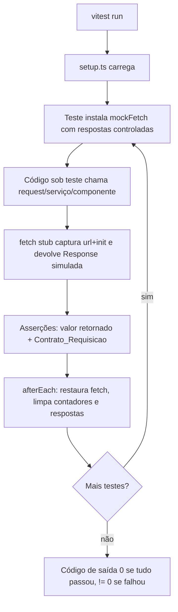

# Design Document

## Overview

Este documento descreve a estratégia e a arquitetura da suíte de testes automatizados do frontend (`web/`) do projeto Selo Sustentável, correspondente à task T48 "Adicionar testes frontend e testes de integração" (Fase 6).

O objetivo é proteger os principais fluxos do frontend integrados à API — unidade de serviços, unidade de componentes/contexto e integração dos percursos críticos (login, cadastro de empresa, proteção de rotas) — com uma suíte determinística, que roda em ambiente limpo (sem API real, banco de dados ou rede) usando interceptação controlada do cliente HTTP.

O frontend usa **Next.js 16.3.3**, **React 19**, **MUI 9** e **TypeScript 5**. Hoje `web/package.json` expõe somente os scripts `dev`, `build`, `start` e `lint`; não há runner de testes. Portanto o design precisa adicionar e configurar toda a infraestrutura de testes.

Alguns alvos listados na task (`services/instituicoes.ts`, `campanhas.ts`, `selos.ts`, `comprovantes.ts`) ainda não existem — dependem de tasks futuras (T35–T46). Esses fluxos são cobertos **condicionalmente**: a suíte testa cada serviço apenas quando o arquivo correspondente existir, tratando os demais como alvos futuros sem quebrar a execução.

### Objetivos de design

- **Determinismo**: nenhum teste depende de serviços externos, ordem de execução ou dados reais.
- **Fidelidade de contrato**: os testes afirmam o contrato HTTP real (método, rota `/api/*`, corpo, formato, `credentials: "include"`) observado em `services/api.ts`.
- **Baixo atrito**: um único comando documentado roda tudo em modo não interativo.
- **Resiliência evolutiva**: módulos de serviço ainda inexistentes não falham a suíte.

### Não objetivos

- Testar comportamento interno de serviços AWS/API (coberto pelos testes de backend).
- Testes de carga/desempenho (ex.: respostas muito grandes).
- Validar o proxy do `next.config.ts` em runtime (não há Next rodando durante os testes; a interceptação ocorre no nível do `fetch`).

## Architecture

### Escolha do runner e ambiente DOM

**Decisão: Vitest + @testing-library/react + @testing-library/user-event + jsdom.** Playwright é **opcional** e fica fora do escopo mínimo da suíte (ver "Testes de navegador").

Justificativa considerando Next 16 / React 19 / MUI 9:

- **Vitest** usa a mesma pipeline de transformação baseada em ESM/Vite, o que casa com o TypeScript 5 e os módulos ESM do projeto sem exigir a configuração pesada de `ts-jest`/Babel. Tem modo de execução única (`vitest run`) nativo, cobertura integrada e `vi.fn`/`vi.stubGlobal` para interceptação — alinhado ao requisito de execução não interativa.
- **@testing-library/react** suporta React 19 e incentiva asserções por papel/nome acessível (query `getByRole`), o que atende diretamente aos requisitos de acessibilidade (Requisito 8) sem acoplar os testes a detalhes de implementação do MUI.
- **@testing-library/user-event** simula interação realista de teclado/ponteiro, necessária para os testes de navegação por teclado (Requisito 8.5).
- **jsdom** fornece o DOM simulado para montar componentes MUI 9 em Node, satisfazendo o Requisito 1.2. O ambiente é configurado globalmente como `jsdom`.

Alternativa considerada e descartada: **Jest**. Funciona, mas exige transformadores adicionais para ESM/TS e tem integração menos direta com a toolchain Vite/ESM do ecossistema Next 16; o ganho de maturidade não compensa o atrito de configuração neste projeto.

### Estratégia de interceptação de rede

O cliente HTTP (`services/api.ts`) chama `fetch("/api" + path, { credentials: "include", ... })`. Durante os testes **não há Next rodando**, logo o rewrite de `/api/*` do `next.config.ts` não existe; a URL `/api/...` nunca atinge rede real. A interceptação é feita no nível do **`fetch` global**.

**Decisão: mock do `fetch` global via `vi.stubGlobal("fetch", ...)`, encapsulado em um helper central (`mockFetch`).** MSW é descartado como dependência obrigatória.

Prós e contras avaliados:

| Abordagem | Prós | Contras |
| --- | --- | --- |
| **Mock de `fetch` global** (escolhida) | Zero dependências extras; controle total e explícito sobre `status`, `headers`, corpo e exceções de rede; captura trivial de `(url, init)` para asserção de contrato; reset simples por teste | Precisa reproduzir a interface `Response` (status, `headers.get`, `json()`); menos "realista" que uma camada de servidor |
| **MSW (Mock Service Worker)** | Intercepta por rota de forma declarativa; mais próximo de HTTP real | Dependência adicional e setup de servidor em Node; a asserção fina de "corpo FormData exato" e "credentials" exige inspeção extra; sobra de abstração para o que a suíte precisa |

A suíte precisa, acima de tudo, **afirmar o contrato de requisição** (método, rota, corpo, FormData, `credentials`) e **simular respostas precisas e falhas de rede**. O mock de `fetch` dá esse controle de forma direta e sem dependências, por isso é a abordagem **única e consistente** adotada em toda a suíte. O helper central padroniza a construção de respostas para evitar reinvenção em cada teste.

### Organização de diretórios

```
web/
├── package.json              # novo script "test": "vitest run"
├── vitest.config.ts          # ambiente jsdom, setupFiles, globals
├── tests/
│   ├── setup.ts              # reset global (afterEach), matchers, guarda anti-rede
│   ├── helpers/
│   │   ├── mockFetch.ts      # Mock_API: stub de fetch, respostas e captura de chamadas
│   │   ├── requestContract.ts# asserção de Contrato_Requisicao
│   │   ├── formData.ts       # utilitário de inspeção de FormData
│   │   ├── authHarness.tsx   # harness para montar AuthProvider e transições de estado
│   │   ├── viewport.ts       # ajuste de largura de viewport (320/1280)
│   │   └── moduleExists.ts   # detecção condicional de serviços opcionais
│   ├── unit/                 # serviços: api, auth, empresas (+ opcionais condicionais)
│   ├── component/            # compLogin, CadastroWizard, AuthProvider/guard
│   └── integration/          # fluxos ponta a ponta no DOM (login→dashboard, estados de UI)
└── playwright.config.ts      # OPCIONAL — somente se e2e de navegador for adotado
```

### Fluxo de execução de um teste



### Guarda contra rede real

O `setup.ts` instala um `fetch` padrão que, se chamado sem um stub configurado para a rota, **lança um erro** identificando o destino não interceptado e falha o teste (Requisito 9.5). Isso garante que nenhuma requisição escape para a rede.

## Components and Interfaces

### Mock_API — `tests/helpers/mockFetch.ts`

Responsável por interceptar `fetch`, devolver respostas pré-definidas e registrar as chamadas para asserção posterior.

```typescript
type RespostaSimulada = {
  status: number;
  // corpo é serializado como JSON quando jsonContentType = true
  body?: unknown;
  jsonContentType?: boolean; // define content-type "application/json" (default: true quando body existe)
  headers?: Record<string, string>;
};

type ChamadaCapturada = {
  url: string;          // ex.: "/api/sessoes"
  method: string;       // normalizado em maiúsculas
  init: RequestInit;
  body: BodyInit | null | undefined;
};

interface MockFetch {
  // Define a resposta para a próxima (ou toda) chamada que casar com o path.
  responderCom(resposta: RespostaSimulada): void;
  responderPara(path: string, resposta: RespostaSimulada): void;
  // Simula exceção de rede (fetch rejeita) — para ApiError(0, ...).
  falharРоRede(): void;
  // Chamadas capturadas, em ordem.
  chamadas: ChamadaCapturada[];
  ultimaChamada(): ChamadaCapturada;
  restaurar(): void; // chamado pelo afterEach global
}

export function instalarMockFetch(): MockFetch;
```

Detalhes de implementação:
- Constrói um objeto compatível com `Response`: expõe `status`, `ok` (derivado de 200–299), `headers.get("content-type")` e `json()`.
- Para 204, devolve `status: 204` sem corpo e sem `content-type`, exercitando o atalho de `undefined` do cliente.
- `falharPorRede()` faz o stub rejeitar com um `Error`, exercitando o `catch` que vira `ApiError(0, ...)`.

### Asserção de contrato — `tests/helpers/requestContract.ts`

```typescript
type ContratoEsperado = {
  metodo: string;             // "POST", "DELETE", ...
  rota: string;               // ex.: "/sessoes" (o helper verifica prefixo "/api")
  credentials?: RequestCredentials; // default esperado: "include"
  corpoJson?: unknown;        // compara corpo parseado por igualdade estrutural
  corpoFormData?: Record<string, string | File>; // compara entradas do FormData
  semContentTypeManual?: boolean; // true: cabeçalho Content-Type não deve existir no init
  contentType?: string;       // valor esperado quando definido manualmente
};

// Verifica a chamada contra o contrato; lança/falha com diferença legível.
export function assertContrato(chamada: ChamadaCapturada, esperado: ContratoEsperado): void;
```

Regras aplicadas:
- A rota efetiva deve iniciar com `/api` e terminar com `esperado.rota` (Requisito 2.5).
- `credentials` deve ser `"include"` salvo override explícito (Requisito 2.5).
- Para `corpoFormData`, usa o utilitário de inspeção de FormData.

### Utilitário de FormData — `tests/helpers/formData.ts`

```typescript
// Converte um FormData em um mapa inspecionável para asserção.
export function lerFormData(fd: FormData): Record<string, string | File>;

// Afirma presença de chaves com valor não vazio.
export function assertCamposPresentes(fd: FormData, chaves: string[]): void;

// Afirma ausência de chaves (campos opcionais omitidos).
export function assertCamposAusentes(fd: FormData, chaves: string[]): void;
```

Usado para validar a montagem do FormData em `criarEmpresa` (Requisito 5): campos obrigatórios presentes/não vazios, opcionais incluídos quando informados e omitidos quando ausentes/vazios.

### Harness de autenticação — `tests/helpers/authHarness.tsx`

Monta o `AuthProvider` real com um `fetch` controlado e expõe utilidades para dirigir as transições de estado (`carregando` → `autenticado` | `nao-autenticado` | `expirada`).

```typescript
type AuthHarness = {
  // Renderiza AuthProvider envolvendo children, com tema MUI aplicado.
  render(children: React.ReactNode): RenderResult;
  // Consome o AuthContext e expõe o valor atual para asserção.
  estadoAtual(): EstadoSessao;
  empresaAtual(): EmpresaAtual | null;
};

export function montarAuth(opts?: { respostaInicialMe?: RespostaSimulada }): AuthHarness;
```

Observações:
- Como o `AuthProvider` dispara `verificar()` (GET `/empresas/me`) no mount, o harness permite configurar a resposta inicial do `/empresas/me` antes de montar.
- Para simular `expirada`, o harness permite uma primeira verificação de sucesso e uma reconsulta posterior com falha (reproduz `jaAutenticouAntes`).
- Um componente sonda (`EstadoProbe`) lê o contexto e renderiza o estado atual em um nó com papel acessível, permitindo asserção estável.

### Guarda de rota (área protegida)

Para os Requisitos 4.6 e 4.7, o harness monta uma área protegida mínima que consome o contexto e aplica a regra: só renderiza conteúdo privado quando `estado === "autenticado"`; em `carregando` não renderiza nem redireciona; em `nao-autenticado`/`expirada` não renderiza conteúdo privado. O `next/navigation` (`useRouter`, `redirect`) é mockado para capturar redirecionamentos sem navegação real.

### Viewport responsivo — `tests/helpers/viewport.ts`

```typescript
// Ajusta window.innerWidth/innerHeight e matchMedia para a largura dada,
// disparando o evento resize para o MUI reavaliar breakpoints.
export function definirViewport(largura: 320 | 1280, altura?: number): void;
```

jsdom não implementa `matchMedia` nativamente; o helper instala um `matchMedia` controlado que resolve as media queries do MUI segundo a largura simulada, permitindo verificar que os controles essenciais renderizam sem corte/sobreposição nas larguras 320 e 1280 (Requisito 8.3, 8.4).

### Detecção condicional — `tests/helpers/moduleExists.ts`

```typescript
// Resolve o caminho do módulo relativo a web/src/services; retorna true se o arquivo existe.
export function servicoExiste(nomeArquivo: string): boolean;

// Importa dinamicamente o módulo apenas quando ele existe.
export function importarSeExistir<T>(nomeArquivo: string): Promise<T | null>;
```

Os blocos de teste dos serviços opcionais usam `describe.skipIf(!servicoExiste("instituicoes.ts"))` (ou equivalente), de modo que, enquanto o módulo não existe, o grupo é **pulado** sem falhar a suíte (Requisito 7). Quando o arquivo passar a existir, os testes passam a rodar automaticamente.

## Data Models

Os testes reutilizam os tipos reais do frontend; não há modelo de dados novo além das estruturas auxiliares da suíte.

### Tipos reais sob teste (de `web/src/services`)

```typescript
// api.ts
class ApiError extends Error {
  status: number;
  message: string;
  fieldErrors: Record<string, string>;
}
type CampoErro = { campo: string; mensagem: string };

// auth.ts
type Papel = "ADMIN" | "EMPRESA" | "INSTITUICAO";
function login(email: string, senha: string): Promise<{ papel: Papel }>;
function logout(): Promise<void>;

// empresas.ts
type CriarEmpresaInput = {
  razaoSocial: string; nomeFantasia: string; cnpj: string; email: string;
  senha: string; telefone: string; cep: string; logradouro: string;
  numero: string; complemento?: string; bairro: string; cidade: string;
  uf: string; contato: string; site?: string; logo?: File | null;
};
function criarEmpresa(input: CriarEmpresaInput): Promise<{ id: string }>;
function getEmpresaAtual(): Promise<EmpresaAtual>;

// AuthContext.tsx
type EstadoSessao = "carregando" | "autenticado" | "nao-autenticado" | "expirada";
```

### Estruturas de dados da suíte

- **RespostaSimulada**: `{ status, body?, jsonContentType?, headers? }` — descreve a resposta que o Mock_API devolve.
- **ChamadaCapturada**: `{ url, method, init, body }` — registro de cada requisição interceptada, base da asserção de contrato.
- **ContratoEsperado**: forma declarada do contrato HTTP esperado para uma chamada.

### Dados de teste (fixtures)

Todos os dados são declarados **inline** em cada teste (Requisito 9.4). Exemplos de referência:

- `empresaValida`: objeto `EmpresaAtual` completo com `id`, `razaoSocial`, etc.
- `inputCadastroCompleto`: `CriarEmpresaInput` com todos os campos obrigatórios e opcionais preenchidos.
- `inputCadastroMinimo`: só obrigatórios, opcionais ausentes/vazios.
- `erroValidacao`: `{ statusCode: 422, message: "...", errors: [{ campo: "email", mensagem: "..." }] }`.

## Correctness Properties

*Uma propriedade é uma característica ou comportamento que deve valer para todas as execuções válidas do sistema — essencialmente uma afirmação formal sobre o que o sistema deve fazer. Propriedades servem de ponte entre especificações legíveis por humanos e garantias de correção verificáveis por máquina.*

As propriedades a seguir derivam da análise de prework dos critérios de aceitação. Elas se aplicam à lógica pura e determinística do frontend (cliente HTTP, montagem de requisições/FormData, mapeamento de erros, invariantes de sessão e de acessibilidade) e à disciplina de isolamento da própria suíte. Critérios classificados como EXAMPLE, EDGE_CASE, SMOKE ou INTEGRATION são cobertos por testes de exemplo/integração na seção Testing Strategy, não por propriedades.

### Property 1: 204 retorna undefined sem parse

*Para qualquer* corpo de resposta, quando o Cliente_HTTP recebe status 204, o retorno é `undefined` e nenhuma tentativa de parse do corpo (`json()`) é realizada.

**Validates: Requirements 2.1**

### Property 2: Round-trip de corpo JSON em respostas 2xx

*Para qualquer* objeto JSON válido devolvido com status na faixa 200–299 e `content-type` contendo `application/json`, o Cliente_HTTP retorna um valor estruturalmente igual ao corpo da resposta.

**Validates: Requirements 2.2**

### Property 3: Mapeamento de erros em ApiError

*Para qualquer* status fora da faixa 200–299 e *para qualquer* lista `errors` de pares `{campo, mensagem}`, o Cliente_HTTP lança um ApiError cujo `status` é igual ao status recebido, cuja `message` é igual à `message` recebida e cujo `fieldErrors` contém exatamente uma entrada por campo, mapeada `campo → mensagem`.

**Validates: Requirements 2.3, 5.6**

### Property 4: Falha de rede vira ApiError com status 0

*Para qualquer* chamada do Cliente_HTTP cuja invocação de `fetch` rejeita, o resultado é um ApiError com `status` igual a 0 e mensagem indicando falha de conexão.

**Validates: Requirements 2.4**

### Property 5: Invariante de prefixo e credenciais

*Para qualquer* requisição realizada pelo Cliente_HTTP, a URL efetiva inicia com o prefixo `/api` e a opção `credentials` tem o valor `"include"`.

**Validates: Requirements 2.5**

### Property 6: Login não toca armazenamento do frontend

*Para quaisquer* credenciais e *para qualquer* fluxo de autenticação exercitado (login ou logout), nenhuma leitura nem gravação de token de sessão ocorre em `localStorage`, `sessionStorage` ou cookies acessíveis pelo frontend.

**Validates: Requirements 3.6**

### Property 7: Área protegida oculta conteúdo privado em sessões inválidas

*Para qualquer* estado de sessão em `{nao-autenticado, expirada}`, a área protegida não renderiza nenhum conteúdo privado.

**Validates: Requirements 4.6**

### Property 8: Cadastro envia POST /empresas com FormData

*Para qualquer* `CriarEmpresaInput` válido, a requisição de `criarEmpresa` usa método POST, rota `/empresas` e corpo do tipo FormData.

**Validates: Requirements 5.1**

### Property 9: Campos obrigatórios sempre presentes no FormData

*Para qualquer* `CriarEmpresaInput` com os campos obrigatórios preenchidos com valor não vazio, o FormData montado por `criarEmpresa` contém todos os campos obrigatórios (`razaoSocial`, `nomeFantasia`, `cnpj`, `email`, `senha`, `telefone`, `cep`, `logradouro`, `numero`, `bairro`, `cidade`, `uf`, `contato`) com valor não vazio.

**Validates: Requirements 5.2**

### Property 10: Opcionais informados são incluídos no FormData

*Para qualquer* `CriarEmpresaInput` em que os campos opcionais (`complemento`, `site`, `logo`) são informados com valor não vazio, cada opcional informado aparece no FormData com o respectivo valor.

**Validates: Requirements 5.3**

### Property 11: Opcionais ausentes são omitidos do FormData

*Para qualquer* `CriarEmpresaInput` em que um ou mais opcionais (`complemento`, `site`, `logo`) são ausentes, nulos ou string vazia, cada opcional correspondente é omitido do FormData.

**Validates: Requirements 5.4**

### Property 12: Cadastro não define Content-Type manual

*Para qualquer* requisição de `criarEmpresa`, o `init` da requisição não define o cabeçalho `Content-Type`, permitindo que o boundary multipart seja definido automaticamente.

**Validates: Requirements 5.5**

### Property 13: Contrato de requisição dos serviços condicionais

*Para qualquer* requisição realizada por um Servico_Opcional existente (`instituicoes.ts`, `campanhas.ts`, `selos.ts`, `comprovantes.ts`), a URL inicia com `/api`, o método e o corpo correspondem ao contrato do serviço e, quando aplicável, `credentials` é `"include"`. (Executada condicionalmente apenas quando o módulo existe.)

**Validates: Requirements 7.6**

### Property 14: Controles críticos têm papel e nome acessível

*Para qualquer* controle interativo crítico das telas de login e cadastro, o controle expõe um papel acessível e um nome acessível não vazio, consultáveis por papel e por nome.

**Validates: Requirements 8.1**

### Property 15: Campo em erro referencia programaticamente sua mensagem

*Para qualquer* campo de formulário crítico que apresenta erro de validação, o campo referencia programaticamente a mensagem de erro correspondente, de modo que a mensagem seja recuperável a partir do campo.

**Validates: Requirements 8.2**

### Property 16: Controles críticos são operáveis por teclado

*Para qualquer* controle interativo crítico, o controle recebe foco por navegação sequencial de teclado e pode ser acionado por teclado sem uso de ponteiro.

**Validates: Requirements 8.5**

### Property 17: Guarda anti-rede bloqueia requisições não interceptadas

*Para qualquer* rota sem resposta configurada no Mock_API, a tentativa de requisição é interrompida antes de qualquer transmissão externa e o teste falha indicando o destino não interceptado.

**Validates: Requirements 9.5**

### Property 18: Independência de ordem de execução

*Para qualquer* par de testes, o resultado de um teste independe do outro ter rodado antes: ao fim de cada teste o Mock_API é restaurado ao estado inicial (sem respostas definidas e com contadores zerados).

**Validates: Requirements 9.6**

## Error Handling

A suíte precisa tratar e, em muitos casos, **afirmar** o comportamento de erro do código sob teste.

### Erros do código sob teste (comportamento esperado e verificado)

- **Falha de rede** (`fetch` rejeita): o Cliente_HTTP converte em `ApiError(0, "Não foi possível conectar com o servidor...")`. O Mock_API expõe `falharPorRede()` para exercitar esse caminho (Propriedade 4; Requisitos 2.4, 3.4, 5.8, 6.6).
- **Respostas não-OK com `errors`**: viram `ApiError(status, message, fieldErrors)` com mapeamento por campo (Propriedade 3; Requisitos 2.3, 5.6).
- **Respostas não-OK sem `errors`** (ex.: 500 genérico): viram `ApiError` com `fieldErrors` vazio — verificado como edge case (Requisito 5.8).
- **401 em fluxos autenticados**: aciona encerramento de sessão local e redirecionamento para login — verificado por exemplo com `useRouter`/`redirect` mockados (Requisito 6.3).
- **Transições de sessão** (`expirada` vs. `nao-autenticado`): dependem do histórico `jaAutenticouAntes`; o harness reproduz a sequência sucesso→falha para cobrir ambos (Requisitos 4.3, 4.4).

### Erros da infraestrutura de teste

- **Requisição não interceptada**: o `setup.ts` instala um `fetch` guarda que lança imediatamente, falhando o teste e nomeando o destino, antes de qualquer tentativa de rede (Propriedade 17; Requisito 9.5).
- **Falta de reset entre testes**: o `afterEach` global restaura `fetch`, limpa contadores e respostas e desfaz stubs de `window`/storage, garantindo independência de ordem (Propriedade 18; Requisito 9.6). Se um teste esquecer de configurar uma resposta, a guarda anti-rede o faz falhar de forma explícita em vez de pendurar.
- **Serviço opcional ausente**: a detecção condicional pula o grupo (`skipIf`) em vez de lançar erro de importação (Requisito 7).
- **Diferenças de asserção**: os helpers (`assertContrato`, `assertCampos*`) produzem mensagens legíveis com esperado × recebido, apoiando o relatório de falha do runner (Requisito 1.5).

## Testing Strategy

### Abordagem dual

- **Testes de exemplo/unidade**: casos concretos, transições de estado específicas, casos de borda e comportamento de UI.
- **Testes de propriedade (PBT)**: invariantes universais sobre a lógica pura e determinística (cliente HTTP, montagem de FormData, mapeamento de erros, invariantes de sessão/acessibilidade e de isolamento da suíte).

Ambos são complementares: os de exemplo capturam cenários concretos e de UI; os de propriedade cobrem amplamente o espaço de entrada.

### Onde PBT se aplica (e onde não)

PBT **se aplica** aqui porque há funções com entrada/saída claras e invariantes universais: o Cliente_HTTP (parse/erros), `login` e `criarEmpresa` (montagem de requisição/FormData) e as invariantes de guarda de sessão e de acessibilidade. Essas são verificáveis como "para todo input X, vale P(X)".

PBT **não se aplica** a: comportamento do runner e configuração (Requisito 1 e 9.1–9.4 — SMOKE), renderização/layout responsivo em larguras fixas (Requisitos 8.3, 8.4 — exemplos/snapshot-like), transições pontuais de estado do contexto (Requisitos 4.1–4.5, 4.7 — exemplos) e fluxos de UI de estados de interface (Requisito 6 — exemplos). Esses usam testes de exemplo/integração e verificações pontuais de configuração.

### Biblioteca de PBT

- Biblioteca escolhida: **fast-check**, integrada ao Vitest. Não implementar PBT do zero.
- Cada teste de propriedade roda no mínimo **100 iterações** (`fc.assert(fc.property(...), { numRuns: 100 })`).
- Cada teste de propriedade referencia a propriedade do design por comentário, no formato:
  **Feature: testes-frontend, Property {número}: {texto da propriedade}**
- Cada propriedade de correção é implementada por um **único** teste de propriedade.

### Mapeamento de requisitos → estratégia de teste

| Requisito | Estratégia |
| --- | --- |
| **1** (infra/execução) | Configuração `vitest.config.ts` (jsdom, `globals`, `setupFiles`); script `test: "vitest run"` em `package.json`; verificação SMOKE de montagem de componente MUI; documentação do comando no README/doc de `web/`. |
| **2** (cliente HTTP) | PBT: Propriedades 1–5 (fast-check) cobrindo 204, round-trip JSON, mapeamento de erro, falha de rede e invariante `/api`+`credentials`. |
| **3** (auth) | PBT para contrato de `login` (3.1) e invariante de storage (Propriedade 6); exemplos/edge para sucesso 200/201 (3.2), 401 (3.3), família 400/422/500/rede (3.4) e logout (3.5). |
| **4** (estados de sessão/guarda) | Exemplos com `authHarness` para transições 4.1–4.5 e 4.7; PBT (Propriedade 7) para a invariante de guarda em estados não autenticados (4.6). `next/navigation` mockado. |
| **5** (cadastro) | PBT: Propriedades 8–12 (POST/FormData, obrigatórios, opcionais incluídos/omitidos, sem Content-Type manual); exemplo para sucesso (5.7); edge para falha não-validação sem `errors` (5.8). |
| **6** (estados de UI) | Exemplos de componente/integração para loader (6.1), vazio (6.2), 401→login (6.3), validação por campo (6.4), erro geral (6.5) e rede com retry (6.6). |
| **7** (serviços opcionais) | Testes **condicionais** (`describe.skipIf`): exemplos de sucesso/falha por serviço (7.1–7.5); PBT condicional de contrato (Propriedade 13 / 7.6) quando o módulo existir. |
| **8** (responsivo/a11y) | PBT para papel+nome acessível (8.1 / Propriedade 14), ligação campo↔erro (8.2 / Propriedade 15) e operabilidade por teclado (8.5 / Propriedade 16); exemplos com `definirViewport` para 320px (8.3) e 1280px (8.4). |
| **9** (isolamento) | SMOKE para interceptação total e exit codes (9.1–9.4); PBT para guarda anti-rede (Propriedade 17 / 9.5) e independência de ordem (Propriedade 18 / 9.6); fixtures inline (9.4). |

### Testes de navegador (opcional)

Testes e2e de navegador com **Playwright** (`web/playwright.config.ts`) ficam fora do escopo mínimo. Se adotados, cobririam percursos ponta a ponta reais contra um ambiente controlado; a suíte determinística baseada em Vitest + jsdom permanece a referência para CI e para os requisitos desta spec, por rodar sem navegador real e sem serviços externos.

### Balanceamento

- Priorizar PBT para a lógica de transformação (cliente HTTP, FormData, mapeamento de erro) — poucos testes cobrindo muitos inputs.
- Usar exemplos com moderação, focados em: transições de estado, pontos de integração (login→dashboard), estados de UI e casos de borda/erro.
- Evitar excesso de testes de exemplo redundantes onde uma propriedade já garante a cobertura.

### Execução e CI

- Comando único e não interativo: `npm test` (→ `vitest run`) a partir de `web/`.
- Exit 0 quando tudo passa; exit ≠ 0 em qualquer falha ou quando nenhum teste é encontrado.
- Determinístico em ambiente limpo: sem API, banco ou rede; toda resposta vem do Mock_API com fixtures inline; `afterEach` global garante independência de ordem.
