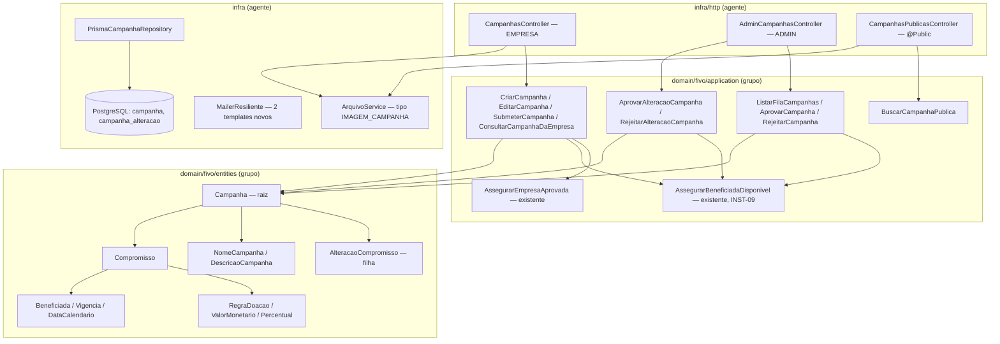

# Campanhas Design

**Spec**: `.specs/features/campanhas/spec.md`
**Context**: `.specs/features/campanhas/context.md`
**Status**: Approved (2026-10-15)

> Convenção: nomes de seção e palavras-chave em inglês, conteúdo em português (AD-005).
> Arquitetura de **AD-017** (hexagonal completa, contexto único `src/domain/fivo/`, rich domain model).

---

## Escopo deste design

Rodada **P1 do `api`** (CAMP-01…08, CAMP-11), decidida com o usuário em 2026-10-15:

1. **Rascunho** — criação com só o nome, edição livre, capa opcional, acesso restrito à empresa dona.
2. **Submissão, fila e decisão do admin** — `RASCUNHO → EM_ANALISE → APROVADA | REJEITADA`, `REJEITADA → RASCUNHO`, com auditoria e e-mail.
3. **Alteração de campanha aprovada** — textos, capa e meta aplicados na hora; beneficiada, regra e vigência viram uma alteração pendente com decisão própria.
4. **Consulta pública** — read model da versão aprovada por identificador público, e a capa servida sem autenticação.

**Fora desta rodada:** encerramento (CAMP-09), duplicação (CAMP-10), `web`, lista de campanhas da empresa (`transparencia-e-area-empresa`), solicitação de selo (`selo-e-qrcode` consome `Campanha.estaAptaASelo()`), página HTML e Open Graph (`paginas-publicas` consome a consulta pública).

**Autoria:** a mesma divisão do AD-020. O domínio (entidades, VOs, erros, portas, casos de uso, fakes, factories e testes unit) é escrito pelo grupo. A infra (Prisma, adaptadores, HTTP, OpenAPI e e2e) fica com o agente, depois do gate de verificação do domínio. A decisão vira um novo AD na fase Tasks.

---

## Approach

**Abordagem A**, escolhida com o usuário: a `Campanha` é a raiz do agregado e contém uma `AlteracaoCompromisso` filha, persistida numa tabela própria com histórico (AD-006 c). As alternativas descartadas foram colunas pendentes na própria campanha (perde o histórico e supersederia o AD-006 c) e versionamento completo (pesado demais para a v1).

| Decisão | Escolha | Origem |
| ------- | ------- | ------ |
| Onde mora a regra | Valor restrito → VO; invariante de estado → método da `Campanha`; regra entre registros (empresa aprovada, beneficiada disponível) → caso de uso | AD-017 |
| Beneficiada | VO `Beneficiada` com XOR instituição/causa; disponibilidade checada por `AssegurarBeneficiadaDisponivelUseCase` (INST-09) | AD-006 a, INST-09 |
| Empresa aprovada | Os casos de uso da empresa compõem `AssegurarEmpresaAprovadaUseCase` → 403 "Cadastro ainda não aprovado" | spec Criação AC1 |
| Concorrência | Bloqueio otimista por `versao` na campanha: `salvar(campanha, versaoEsperada)` devolve `false` → 409 | spec Edge cases; ver Tech Decisions |
| Datas | VO `DataCalendario` (`AAAA-MM-DD`), "hoje" calculado em America/Sao_Paulo | context.md |
| Dinheiro e percentual | Inteiros (centavos; centésimos de ponto); o HTTP manda string decimal, e o VO faz o parse e valida as casas | context.md |
| Erros | `Either` em todo o domínio; o `DomainExceptionFilter` converte `status` em HTTP | padrão vigente |

---

## Architecture Overview



---

## Code Reuse Analysis

### Componentes existentes a aproveitar

| Componente | Local | Uso |
| ---------- | ----- | --- |
| `Entity`, `ValueObject`, `UniqueEntityId`, `Either` | `src/core/` | base de `Campanha`, `AlteracaoCompromisso` e VOs; `UniqueEntityId` (UUID v4, `randomUUID`) gera o `idPublico` não sequencial |
| `AssegurarEmpresaAprovadaUseCase` | `application/use-cases/assegurar-empresa-aprovada.ts` | composto nos casos de uso da empresa (403 com a mensagem da spec) |
| `AssegurarBeneficiadaDisponivelUseCase` | `application/use-cases/assegurar-beneficiada-disponivel.ts` | composto em criar/editar/submeter (422) e nas aprovações (convertido em 409) |
| `BeneficiadaAmbiguaError`, `BeneficiadaIndisponivelError`, `MotivoInsuficienteError`, `TransicaoInvalidaError`, `InvalidRuleValueError`, `StorageIndisponivelError`, `NotAllowedError`, `ResourceNotFoundError` | `application/errors/`, `src/core/errors/` | reuso direto; as mensagens já batem com a spec |
| Padrão aprovar/rejeitar com auditoria e e-mail | `aprovar-instituicao.ts`, `rejeitar-instituicao.ts` | mesmo fluxo: checa papel → carrega → método da entidade → salva com guarda → audita → e-mail em try/catch |
| `RegistroAuditoriaRepository.registrar` | `application/ports/registro-auditoria-repository.ts` | `tipo` livre: `CAMPANHA_SUBMETIDA`, `CAMPANHA_APROVADA`, `CAMPANHA_REJEITADA`, `CAMPANHA_REABERTA`, `ALTERACAO_CAMPANHA_ABERTA`, `ALTERACAO_CAMPANHA_APROVADA`, `ALTERACAO_CAMPANHA_REJEITADA` |
| `Mailer` + `MailerResiliente` + `email_pendente` | `application/ports/mailer.ts`, `src/infra/mail/` | dois templates novos, incluídos em `TEMPLATES_ENFILEIRAVEIS` |
| `Arquivo.criar` + `ArquivoService.uploadImagem/remover/lerBytes` | `entities/arquivo.ts:121`, `src/infra/arquivo/arquivo.service.ts` | novo tipo `IMAGEM_CAMPANHA` (PNG/JPEG, 5 MB, sem checagem de 512×512) |
| `ZodValidationPipe`, `desembrulhar`, `DomainExceptionFilter`, `@Roles`, `@Public`, `@CurrentUser`, `esquemaOpenApi`, `@ApiErro`, `@ApiProtegida` | `src/infra/http/`, `src/infra/auth/` | controllers no mesmo formato de `admin-instituicoes` e `beneficiadas` |
| `PrismaTransactionContext` + `PrismaUnitOfWork` | `src/infra/database/prisma/` | o `salvar` grava campanha e alteração na mesma transação |
| `criarAppDeTeste`, `limparBanco`, `comCookieDeSessao` | `test/helpers/e2e-app.ts` | e2e; acrescentar as duas tabelas novas ao `TRUNCATE` |
| `test/http/openapi-paridade.e2e-spec.ts` | — | cobre as rotas novas sem mudança |

### Integration points

| Sistema | Integração |
| ------- | ---------- |
| `catalogo-instituicoes` | Leitura de `Instituicao.estaDisponivelParaSelecao()` e `Causa.estaAtiva()` via INST-09; o read model público lê o nome da instituição (`nomeFantasia`) ou da causa (`nome`) |
| `cadastro-empresa` | `Empresa.estaAprovada()` para o portão de escrita e para a visibilidade pública; e-mail do `Usuario` dono para notificar rejeições |
| `selo-e-qrcode` (futuro) | Consome `Campanha.estaAptaASelo()` e `idPublico` |
| `paginas-publicas` (futuro) | Consome `BuscarCampanhaPublicaUseCase` e estende o read model |

---

## Components

### Domínio — `src/domain/fivo/` (autoria do grupo)

#### Value objects — `entities/`

| VO | Fábrica | Regra | Erro (status) |
| -- | ------- | ----- | ------------- |
| `NomeCampanha` | `criar(bruto: string)` | trim; 3–80 caracteres | `NomeCampanhaInvalidoError` (422, "O nome deve ter entre 3 e 80 caracteres") |
| `DescricaoCampanha` | `criar(bruto: string)` | até 2000 caracteres; texto guardado como veio (sem escape) | `DescricaoCampanhaInvalidaError` (422, "A descrição deve ter no máximo 2000 caracteres") |
| `ValorMonetario` | `deDecimal(texto: string)` | `^\d{1,6}(\.\d{1,2})?$`; R$ 0,01–999.999,99; guarda `centavos: number` | `ValorMonetarioInvalidoError` (422, "O valor deve estar entre R$ 0,01 e R$ 999.999,99, com no máximo 2 casas decimais") |
| `Percentual` | `deDecimal(texto: string)` | `^\d{1,3}(\.\d{1,2})?$`; 0,01–100,00; guarda `centesimos: number` | `PercentualInvalidoError` (422, "O percentual deve estar entre 0,01% e 100,00%, com no máximo 2 casas decimais") |
| `RegraDoacao` | `criar({ tipo, valor?, percentual? })` | `POR_UNIDADE` exige só `valor`; `PERCENTUAL` exige só `percentual`; o valor do outro tipo presente → erro | `InvalidRuleValueError` (422, mensagem existente) + os erros de `ValorMonetario`/`Percentual` |
| `Beneficiada` | `criar({ instituicaoId?, causaId? })` | exatamente um dos dois | `BeneficiadaAmbiguaError` (422) |
| `DataCalendario` | `criar(texto: string)`, `hojeEm(agora: Date)` | `AAAA-MM-DD` válido; `hojeEm` usa `Intl.DateTimeFormat` com `timeZone: 'America/Sao_Paulo'`; `ehAnteriorA`, `ehPosteriorA` | `DataInvalidaError` (422, "Data inválida. Use o formato AAAA-MM-DD") |
| `Vigencia` | `criar({ inicio, fim? })` | `fim`, se houver, estritamente posterior a `inicio`; início no passado é aceito; `naoIniciadaEm(hoje)`, `fimJaPassouEm(hoje)` (fim ≤ hoje) | `VigenciaInvalidaError` (422, "A data de fim deve ser posterior à data de início") |
| `Compromisso` | `criar({ beneficiada, regraDoacao, vigencia })` | os três obrigatórios; usado na alteração pendente e como retrato da versão aprovada | — |

#### `Campanha` (entidade raiz) — **retrabalho** de `entities/campanha.ts`

- **Props:** `empresaId: UniqueEntityId`, `idPublico: UniqueEntityId`, `nome: NomeCampanha`, `descricao?: DescricaoCampanha`, `capaArquivoId?: UniqueEntityId`, `beneficiada?: Beneficiada`, `regraDoacao?: RegraDoacao`, `meta?: ValorMonetario`, `vigencia?: Vigencia`, `status: CampanhaStatus`, `submetidaEm?`, `decididoPor?`, `decididoEm?`, `motivoUltimaRejeicao?`, `alteracaoPendente?: AlteracaoCompromisso`, `versao: number`, `createdAt`, `updatedAt?`.
- **`CampanhaStatus`:** `RASCUNHO`, `EM_ANALISE`, `APROVADA`, `REJEITADA` (`ENCERRADA` entra com CAMP-09).
- **Métodos** (todos devolvem `Either`; nenhum setter público):
  - `static criar({ empresaId, nome })` → `RASCUNHO`, `idPublico` novo, `versao = 0`.
  - `editarTextos({ nome?, descricao?, capaArquivoId?, meta? })` — em `RASCUNHO` e `APROVADA` aplica; em `REJEITADA` aplica e volta para `RASCUNHO`; em `EM_ANALISE` → `CampanhaEmAnaliseError` (409, "Campanha em análise não pode ser editada").
  - `editarCompromisso({ beneficiada?, regraDoacao?, vigencia? })`:
    - em `RASCUNHO` ou `REJEITADA`, aplica direto (`REJEITADA → RASCUNHO`);
    - em `APROVADA`, abre uma `AlteracaoCompromisso` com o compromisso atual mesclado ao novo, ou devolve `AlteracaoJaPendenteError` (409, "Já existe uma alteração em análise");
    - em `EM_ANALISE`, devolve `CampanhaEmAnaliseError`.
  - `submeter(hoje: DataCalendario)` — só em `RASCUNHO` (senão `TransicaoInvalidaError`). Se faltar campo, devolve `CamposPendentesError` (422) com a lista completa: `descricao`, `beneficiada`, `regraDoacao`, `vigencia.inicio`. Se `vigencia.fimJaPassouEm(hoje)`, devolve `VigenciaVencidaError` (422, "A data de fim deve ser posterior à data atual"). Em caso de sucesso, passa a `EM_ANALISE` e grava `submetidaEm`.
  - `aprovar(adminId)` — `EM_ANALISE → APROVADA`; grava `decididoPor`/`decididoEm`.
  - `rejeitar(adminId, motivo)` — `EM_ANALISE → REJEITADA`; motivo com trim ≥ 20 (`MotivoInsuficienteError`); grava `motivoUltimaRejeicao`, que **não** é apagado ao voltar para `RASCUNHO`.
  - `aprovarAlteracao(adminId)` / `rejeitarAlteracao(adminId, motivo)` — sem alteração pendente → `TransicaoInvalidaError`. Aprovar copia o `Compromisso` proposto para a campanha; rejeitar só fecha a alteração. Nos dois casos a campanha segue `APROVADA` e `alteracaoPendente` fica vazio.
  - `estaAptaASelo()` → `status === APROVADA`.
  - `estaPublicada()` → `status === APROVADA` (a empresa aprovada é checada no caso de uso).
  - `camposPendentes()`, `compromissoVigente(): Compromisso | null`.

#### `AlteracaoCompromisso` (entidade filha) — novo

- **Props:** `campanhaId`, `proposto: Compromisso`, `anterior: Compromisso`, `status: AlteracaoStatus` (`EM_ANALISE`, `APROVADA`, `REJEITADA`), `createdAt`, `decididoPor?`, `decididoEm?`, `motivo?`.
- Só a `Campanha` cria e decide; não existe repositório próprio.

#### Erros de aplicação novos — `application/errors/`

`NomeCampanhaInvalidoError`, `DescricaoCampanhaInvalidaError`, `ValorMonetarioInvalidoError`, `PercentualInvalidoError`, `DataInvalidaError`, `VigenciaInvalidaError`, `VigenciaVencidaError` (todos 422); `CamposPendentesError` (422, "Preencha os campos obrigatórios antes de enviar para análise", com `campos: string[]`); `CampanhaEmAnaliseError`, `AlteracaoJaPendenteError` (409); `BeneficiadaIndisponivelNaDecisaoError` (409, "A beneficiada não está mais disponível no catálogo").

#### Portas

- `CampanhaRepository` (**retrabalho**):
  - `findById(id)`, `findByIdPublico(idPublico)`;
  - `create(campanha)`;
  - `salvar(campanha, versaoEsperada): Promise<boolean>`, que grava campanha e alteração juntas e incrementa `versao`;
  - `listarEmAnalise(): Promise<Campanha[]>`, que traz as campanhas `EM_ANALISE` e as `APROVADA` com alteração pendente.
- `Mailer`: `TemplateEmail.CAMPANHA_REJEITADA` e `TemplateEmail.ALTERACAO_CAMPANHA_REJEITADA`, ambos com `dados: { nomeCampanha, motivo }`.
- Reusadas sem mudança: `EmpresaRepository`, `UserRepository`, `InstituicaoRepository`, `CausaRepository`, `RegistroAuditoriaRepository`.

#### Casos de uso — `application/use-cases/` (um por operação, `@Injectable()`)

| Caso de uso | Entrada | Saída | Regras compostas |
| ----------- | ------- | ----- | ---------------- |
| `CriarCampanhaUseCase` (**retrabalho**) | `{ empresaId, nome, descricao?, beneficiada?, regraDoacao?, meta?, vigencia?, capaArquivoId? }` (primitivos) | `{ id, idPublico }` | empresa aprovada → VOs → beneficiada disponível, se informada → `Campanha.criar` + `editar*` → `create` |
| `EditarCampanhaUseCase` | `{ empresaId, campanhaId, ...campos parciais }` | read model do detalhe | empresa aprovada → dona (senão 404) → VOs → beneficiada disponível, se alterada → `editarTextos`/`editarCompromisso` → `salvar(versao)` → auditoria se reabriu ou abriu alteração |
| `SubmeterCampanhaUseCase` | `{ empresaId, campanhaId }` | `void` | empresa aprovada → dona → beneficiada disponível (422) → `submeter(hoje)` → `salvar` → auditoria |
| `ConsultarCampanhaDaEmpresaUseCase` | `{ empresaId, campanhaId }` | `CampanhaDetalhe` | dona (senão 404); vale para empresa em qualquer estado, porque leitura não exige aprovação |
| `ListarFilaCampanhasUseCase` | `{ user }` | `ItemFilaCampanhas[]` | ADMIN → `listarEmAnalise` → monta itens `NOVA`/`ALTERACAO` com nome da empresa, beneficiada, regra, vigência e `submetidoEm` (submissão ou abertura da alteração) → ordena asc |
| `AprovarCampanhaUseCase` / `RejeitarCampanhaUseCase` | `(campanhaId, user[, motivo])` | `void` | ADMIN → carrega → (aprovar: beneficiada disponível, senão 409) → método → `salvar` (falso → 409) → auditoria → (rejeitar: e-mail ao dono) |
| `AprovarAlteracaoCampanhaUseCase` / `RejeitarAlteracaoCampanhaUseCase` | `(campanhaId, user[, motivo])` | `void` | igual ao par acima, sobre a alteração pendente; a auditoria grava os compromissos anterior e proposto |
| `BuscarCampanhaPublicaUseCase` | `{ idPublico }` | `CampanhaPublica` (read model) | `idPublico` malformado, campanha não publicada ou empresa não aprovada → o mesmo `ResourceNotFoundError('Campanha não encontrada')`; `situacao` = `NAO_INICIADA` ou `EM_ANDAMENTO` por `hojeEm(new Date())` |

`CampanhaPublica` não tem os campos `id`, `motivo*` nem `alteracaoPendente`. A omissão vem da construção do tipo, não de um presenter, seguindo a mesma ideia do `BeneficiadaDisponivel` do catálogo.

### Infra — `src/infra/` (autoria do agente, depois do gate)

| Peça | Local | Detalhe |
| ---- | ----- | ------- |
| Schema e migration | `prisma/schema.prisma`, `prisma/migrations/<ts>_campanhas` | modelos `Campanha` e `CampanhaAlteracao`, enums novos, valor `IMAGEM_CAMPANHA` em `tipo_arquivo`, SQL manual com CHECK e índice parcial (ver Data Models) |
| `PrismaCampanhaMapper` + `PrismaCampanhaRepository` | `src/infra/database/prisma/` | `salvar` faz `updateMany where { id, versao: esperada }` com `versao + 1`, e `upsert` da alteração na mesma transação; `DataCalendario` ↔ `@db.Date` sem deslocamento de fuso |
| Binding da porta | `src/infra/database/database.module.ts` | `{ provide: CampanhaRepository, useClass: PrismaCampanhaRepository }` |
| `Arquivo` / `ArquivoService` | `entities/arquivo.ts` (as três tabelas por tipo), `arquivo.service.ts` | `IMAGEM_CAMPANHA`; `buscarAcesso` reconhece a empresa dona da campanha |
| Templates de e-mail | `src/infra/mail/` | `TEMPLATES_ENFILEIRAVEIS` inclui os dois novos |
| `CampanhasController` (EMPRESA) | `src/infra/http/controllers/campanhas.controller.ts` | `POST /campanhas` (JSON) → 201 `{ id, idPublico }`; `GET /campanhas/:id`; `PATCH /campanhas/:id` (JSON) → 200 detalhe; `PUT /campanhas/:id/capa` (multipart `capa`, limite 5 MB) → 204; `POST /campanhas/:id/submissao` → 204 |
| `AdminCampanhasController` (ADMIN) | `admin-campanhas.controller.ts` | `GET /admin/campanhas/fila`; `POST /admin/campanhas/:id/aprovacao`, `/rejeicao`, `/alteracao/aprovacao`, `/alteracao/rejeicao` → 204 |
| `CampanhasPublicasController` (`@Public`) | `campanhas-publicas.controller.ts` | `GET /campanhas/publicas/:idPublico` → 200 `CampanhaPublica`; `GET /campanhas/publicas/:idPublico/capa` → bytes, só quando a campanha está publicada |
| DTOs zod | `src/infra/http/campanhas.dto.ts` | valores monetários e percentual como **string** decimal; datas como `AAAA-MM-DD`; zod só valida a forma, e o VO valida a regra |
| OpenAPI, e2e, README | `test/http/campanhas*.e2e-spec.ts`, `README.md` | um e2e por história; concorrência com `Promise.all` em duas decisões |

---

## Data Models

```prisma
enum CampanhaStatus { RASCUNHO EM_ANALISE APROVADA REJEITADA  @@map("campanha_status") }
enum AlteracaoCampanhaStatus { EM_ANALISE APROVADA REJEITADA  @@map("alteracao_campanha_status") }
enum TipoRegraDoacao { POR_UNIDADE PERCENTUAL  @@map("tipo_regra_doacao") }

model Campanha {
  id                       String          @id
  idPublico                String          @unique @map("id_publico")
  empresaId                String          @map("empresa_id")
  nome                     String
  descricao                String?
  capaArquivoId            String?         @unique @map("capa_arquivo_id")
  instituicaoId            String?         @map("instituicao_id")
  causaId                  String?         @map("causa_id")
  regraTipo                TipoRegraDoacao? @map("regra_tipo")
  regraValorCentavos       Int?            @map("regra_valor_centavos")
  regraPercentualCentesimos Int?           @map("regra_percentual_centesimos")
  metaCentavos             Int?            @map("meta_centavos")
  dataInicio               DateTime?       @db.Date @map("data_inicio")
  dataFim                  DateTime?       @db.Date @map("data_fim")
  status                   CampanhaStatus
  submetidaEm              DateTime?       @map("submetida_em")
  decididoPor              String?         @map("decidido_por")
  decididoEm               DateTime?       @map("decidido_em")
  motivoUltimaRejeicao     String?         @map("motivo_ultima_rejeicao")
  versao                   Int             @default(0)
  criadoEm                 DateTime        @map("criado_em")
  atualizadoEm             DateTime?       @map("atualizado_em")
  // relações: empresa, instituicao?, causa?, capa? (Arquivo), alteracoes[]
  @@index([status])
  @@index([empresaId])
  @@map("campanha")
}

model CampanhaAlteracao {
  id                        String                  @id
  campanhaId                String                  @map("campanha_id")
  instituicaoId             String?                 @map("instituicao_id")
  causaId                   String?                 @map("causa_id")
  regraTipo                 TipoRegraDoacao         @map("regra_tipo")
  regraValorCentavos        Int?                    @map("regra_valor_centavos")
  regraPercentualCentesimos Int?                    @map("regra_percentual_centesimos")
  dataInicio                DateTime                @db.Date @map("data_inicio")
  dataFim                   DateTime?               @db.Date @map("data_fim")
  status                    AlteracaoCampanhaStatus
  motivo                    String?
  decididoPor               String?                 @map("decidido_por")
  decididoEm                DateTime?               @map("decidido_em")
  criadoEm                  DateTime                @map("criado_em")
  @@index([campanhaId])
  @@map("campanha_alteracao")
}
```

O compromisso **anterior** da alteração não vira coluna: é sempre o que está na campanha enquanto ela está pendente, e o registro de auditoria guarda anterior e proposto no momento da decisão.

**SQL manual na migration** (o primeiro do projeto):

```sql
ALTER TABLE campanha ADD CONSTRAINT campanha_beneficiada_xor
  CHECK (instituicao_id IS NULL OR causa_id IS NULL);
ALTER TABLE campanha_alteracao ADD CONSTRAINT campanha_alteracao_beneficiada_xor
  CHECK ((instituicao_id IS NULL) <> (causa_id IS NULL));
CREATE UNIQUE INDEX campanha_alteracao_uma_pendente
  ON campanha_alteracao (campanha_id) WHERE status = 'EM_ANALISE';
```

Na campanha, o CHECK aceita nenhuma beneficiada, porque o rascunho pode estar incompleto. A regra "exatamente uma" vale na submissão (domínio). Na alteração, o compromisso é sempre completo.

**Relações:** `Campanha` N–1 `Empresa`, N–0..1 `Instituicao`, N–0..1 `Causa`, 1–0..1 `Arquivo` (capa), 1–N `CampanhaAlteracao`.

---

## Error Handling Strategy

| Cenário | Tratamento | Resposta |
| ------- | ---------- | -------- |
| Empresa não aprovada escreve | `AssegurarEmpresaAprovadaUseCase` → `NotAllowedError` | 403 "Cadastro ainda não aprovado" |
| Campanha de outra empresa, ou inexistente | caso de uso compara `empresaId` → `ResourceNotFoundError` | 404 |
| Nome, descrição, valor, percentual, data ou vigência inválidos | VO correspondente | 422 com a mensagem do VO |
| Valor do outro tipo de regra | `RegraDoacao.criar` → `InvalidRuleValueError` | 422 |
| Instituição e causa juntas | `Beneficiada.criar` → `BeneficiadaAmbiguaError` | 422 |
| Beneficiada indisponível ao salvar ou submeter | `AssegurarBeneficiadaDisponivelUseCase` | 422 "Instituição ou causa indisponível" |
| Beneficiada indisponível na aprovação (campanha ou alteração) | caso de uso converte para `BeneficiadaIndisponivelNaDecisaoError` | 409, estado inalterado |
| Submissão incompleta | `CamposPendentesError` | 422 com `campos` (no corpo, em `errors`) |
| Fim ≤ hoje na submissão | `VigenciaVencidaError` | 422 |
| Edição em análise | `CampanhaEmAnaliseError` | 409 |
| Segunda alteração pendente | `AlteracaoJaPendenteError`; o índice parcial barra a corrida no banco | 409 |
| Transição fora do mapa | `TransicaoInvalidaError` | 409 "Operação não permitida para o estado atual" |
| Duas decisões ou decisão contra edição concorrente | `salvar` devolve `false` → `TransicaoInvalidaError` | 409 na segunda |
| Motivo curto | `MotivoInsuficienteError` | 422 |
| Não-ADMIN na fila ou nas decisões | `@Roles(ADMIN)` + `NotAllowedError` no caso de uso | 403 |
| Capa com formato ou tamanho inválido | `Arquivo.criar` / multer | 422 |
| Storage fora do ar no upload da capa | `StorageIndisponivelError` | 503, campanha inalterada |
| Falha ao enviar e-mail | `MailerResiliente` enfileira; caso de uso ignora o erro | decisão gravada |
| Consulta pública não publicada ou malformada | `ResourceNotFoundError('Campanha não encontrada')` | 404 com corpo idêntico |

---

## Risks & Concerns

| Concern | Local | Impacto | Mitigação |
| ------- | ----- | ------- | ---------- |
| Rascunho de campanha fora da spec e do AD-017 (snake_case, entidades embutidas, float em BRL, estados errados, regra no caso de uso) | `entities/campanha.ts:12-36`, `use-cases/criar-campanha.ts:55-77`, `test/factories/campanha-factory.ts`, `test/repositories/in-memory-campanha-repository.ts` | Nada pode ser aproveitado como está; quebra de compilação ao reescrever | Retrabalho no lugar, numa task de domínio que reescreve entidade, factory, fake e spec juntos e mantém o gate verde |
| A auditoria não entra na transação | `PrismaRegistroAuditoriaRepository` usa `this.prisma` | Uma transição pode ficar sem registro se a auditoria falhar depois do `salvar` | Mesmo risco aceito em empresa e instituição; registrar como follow-up do projeto, sem resolver só aqui |
| SQL manual (CHECK e índice parcial) que o Prisma 6.19 não representa no schema | migration nova | `prisma migrate dev` pode acusar drift ou tentar removê-los. **Não verifiquei** como o Prisma 6.19 trata índice parcial criado por SQL | A task de schema roda `prisma migrate dev` duas vezes e confirma que nenhuma migration nova é gerada; se houver drift, fica só o CHECK, e a unicidade da alteração pendente se apoia na `versao` |
| Mapeamento `@db.Date` ↔ `Date` JS com fuso | mapper novo | Data salva com um dia de diferença | O mapper converte por `toISOString().slice(0, 10)` e grava `new Date('AAAA-MM-DDT00:00:00Z')`; e2e confere ida e volta com `2026-01-01` |
| Fila com consultas por item (N+1) | `ListarFilaCampanhasUseCase` | A fila fica lenta com volume alto | Mesmo padrão da fila de instituições; volume da v1 é baixo. Follow-up se crescer |
| Capa pública versus regra do AD-016 (bytes só pelo `GET /arquivos/:id` com controle de acesso) | `CampanhasPublicasController` | A página pública não teria imagem; ou vazaria capa de rascunho | Rota dedicada que só serve a capa de campanha publicada de empresa aprovada; e2e cobre 404 em rascunho |
| Capa substituída deixa o arquivo antigo órfão | `PUT /campanhas/:id/capa` | Lixo no storage | O controller remove o arquivo antigo depois do `salvar` bem-sucedido, e o novo se o `salvar` falhar (padrão `descartar`) |
| Limite de 5 MB do multer com o mesmo off-by-one do logo | `cadastro-empresa.controller.ts:57` | Capa de exatamente 5 MB rejeitada | O interceptor da capa usa `5 * 1024 * 1024 + 1`; e2e com 5 MB exatos aceito |
| Templates de e-mail novos fora de `TEMPLATES_ENFILEIRAVEIS` | `src/infra/mail/mailer-resiliente.ts` | Falha de envio perderia a notificação de rejeição | A task de infra de e-mail inclui os dois templates no conjunto, com teste |

---

## Tech Decisions (feature-local)

| Decisão | Escolha | Racional |
| ------- | ------- | -------- |
| Guarda de concorrência | Coluna `versao` (bloqueio otimista) em vez de `salvarTransicao(estadoEsperado)` | A decisão de uma alteração não muda o `status` da campanha, então o CAS por estado não pega duas decisões simultâneas sobre a mesma alteração, nem uma edição de texto concorrente com a aprovação, que sobrescreveria o compromisso recém-aprovado |
| Um caso de uso `EditarCampanha` para textos e compromisso | A entidade decide o efeito pelo estado | Um `PATCH` com campos mistos não precisa ser quebrado no controller; as regras ficam no domínio |
| Valores pelo HTTP como string decimal | `"1.50"`, `"12.5"` | Evita perder casas decimais com `number` em JSON; quem valida as casas é o VO, que é do domínio |
| "Hoje" sem porta de relógio | `DataCalendario.hojeEm(new Date())` dentro do caso de uso; testes com `jest.useFakeTimers` (já usado em `user.spec.ts`) | Não cria porta nova para uma única leitura de tempo; segue o uso de `new Date()` no resto do projeto |
| Composição de casos de uso de guarda | `CriarCampanha` e afins recebem `AssegurarEmpresaAprovadaUseCase` e `AssegurarBeneficiadaDisponivelUseCase` por injeção | O INST-09 foi desenhado para isso; o portão "Cadastro ainda não aprovado" fica testável no unit |
| Capa por rota multipart separada | `PUT /campanhas/:id/capa` | Mantém criação e edição em JSON puro e o upload isolado com seu limite |

---

## Requirement Traceability (design)

| Requirement | Componentes |
| ----------- | ----------- |
| CAMP-01 | `NomeCampanha`, `DescricaoCampanha`, `Campanha.criar/editarTextos`, `CriarCampanhaUseCase`, `EditarCampanhaUseCase`, `ConsultarCampanhaDaEmpresaUseCase`, `Arquivo` (`IMAGEM_CAMPANHA`), `CampanhasController` |
| CAMP-02 | `RegraDoacao`, `ValorMonetario`, `Percentual` |
| CAMP-03 | `Beneficiada`, `AssegurarBeneficiadaDisponivelUseCase`, CHECK XOR |
| CAMP-04 | `idPublico` (`UniqueEntityId`), índice único `id_publico` |
| CAMP-05 | `SubmeterCampanhaUseCase`, `ListarFilaCampanhasUseCase`, `AprovarCampanhaUseCase`, `RejeitarCampanhaUseCase`, `AdminCampanhasController`, templates de e-mail |
| CAMP-06 | `Campanha` (transições), `CampanhaRepository.salvar` com `versao`, `RegistroAuditoriaRepository` |
| CAMP-07 | `Campanha.editarTextos` em `APROVADA` |
| CAMP-08 | `AlteracaoCompromisso`, `Compromisso`, `Campanha.editarCompromisso/aprovarAlteracao/rejeitarAlteracao`, casos de uso de alteração, índice parcial |
| CAMP-11 | `BuscarCampanhaPublicaUseCase`, `CampanhaPublica`, `CampanhasPublicasController` (dados e capa) |
| CAMP-09, CAMP-10 | fora desta rodada |
