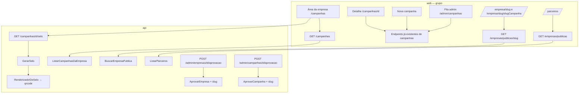

# Vitrine e Selo Design

**Spec**: `.specs/features/vitrine-e-selo/spec.md`
**Status**: Draft

---

## Architecture Overview

Três frentes, com autoria do AD-023: **domínio** (grupo), **infra do `api`** (agente, depois do gate de handoff do domínio) e **`web`** (grupo, 6 pessoas). Os contratos HTTP abaixo são fixados agora para que o `web` comece no mesmo dia que o domínio, com dados fictícios tipados no formato exato do contrato, e troque pela chamada real quando a infra entrar.



---

## Contratos HTTP (fixos para o `web`)

Todos os corpos de erro seguem o formato atual do `DomainExceptionFilter` (`{ statusCode, message }`), lido no `web` por `mensagemDeErro`. Decimais são strings (`"1.50"`), datas são `AAAA-MM-DD`, como nos endpoints de `campanhas`.

### `GET /campanhas` — papel `EMPRESA` (VIT-02)

```jsonc
// 200 — mais recente primeiro
[
  {
    "id": "uuid",
    "nome": "Água Limpa",
    "status": "RASCUNHO | EM_ANALISE | APROVADA | REJEITADA",
    "regraDoacao": { "tipo": "POR_UNIDADE", "valor": "1.00" } /* ou { "tipo": "PERCENTUAL", "percentual": "2.50" } ou null */,
    "urlPublica": "https://fivo.../empresa/cafe-serra-verde/agua-limpa" /* null fora de APROVADA */
  }
]
// 403 sem papel EMPRESA
```

### `GET /campanhas/{id}/selo` — papel `EMPRESA` (VIT-04)

- `200` `image/svg+xml`, `Content-Disposition: attachment; filename="selo-{slugCampanha}.svg"`.
- `404` `"Campanha não encontrada"` (inexistente ou de outra empresa); `409` `"Campanha não está aprovada"`; `403` sem papel `EMPRESA`.

### `GET /empresas/publicas` — público (VIT-08)

```jsonc
// 200 — nomeFantasia em ordem alfabética, sem diferenciar caixa nem acento
[{ "slug": "cafe-serra-verde", "nomeFantasia": "Café Serra Verde", "cidade": "Campinas", "uf": "SP", "temLogo": true }]
```

### `GET /empresas/publicas/{slug}` — público (VIT-06)

```jsonc
// 200
{
  "slug": "cafe-serra-verde",
  "nomeFantasia": "Café Serra Verde",
  "cidade": "Campinas",
  "uf": "SP",
  "site": "https://cafeserraverde.com.br",
  "temLogo": true,
  "campanhas": [ // só APROVADA, aprovação mais recente primeiro
    {
      "slug": "agua-limpa",
      "nome": "Água Limpa",
      "descricao": "texto",
      "beneficiada": { "tipo": "INSTITUICAO | CAUSA", "nome": "Instituto X" },
      "regraDoacao": { "tipo": "POR_UNIDADE", "valor": "1.00" },
      "vigencia": { "inicio": "2026-11-01", "fim": "2027-01-31" /* opcional */ },
      "situacao": "NAO_INICIADA | EM_ANDAMENTO"
    }
  ]
}
// 404 "Empresa não encontrada" — mesmo corpo para slug inexistente e empresa fora de APROVADA
```

### `GET /empresas/publicas/{slug}/logo` — público (VIT-06 AC5)

- `200` bytes com o `Content-Type` do arquivo, `X-Content-Type-Options: nosniff`, como `GET /campanhas/publicas/{idPublico}/capa`; `404` nos demais casos.

### Endpoints já existentes usados pelo `web` (VIT-10…12)

Sem mudança de contrato; o formato está no OpenAPI (`/docs`): `POST /campanhas`, `GET`/`PATCH /campanhas/{id}`, `PUT /campanhas/{id}/capa`, `POST /campanhas/{id}/submissao`, `GET /admin/campanhas/fila`, `POST /admin/campanhas/{id}/aprovacao|rejeicao`, `POST /admin/campanhas/{id}/alteracao/aprovacao|rejeicao` (corpo `{ "motivo" }`). A beneficiada em `GET /campanhas/{id}` vem só como `{ tipo, id }`; o nome sai de `services/instituicoes.ts` (`SeletorBeneficiada`).

---

## Code Reuse Analysis

### Existing Components to Leverage

| Component | Location | How to Use |
| --------- | -------- | ---------- |
| `descreverRegra`, `descreverVigencia` | `src/domain/fivo/campanhas/use-cases/campanha-detalhe.ts` | Formato de `regraDoacao` e `vigencia` nas respostas novas |
| Resolução de beneficiada e `situacao` | `src/domain/fivo/campanhas/use-cases/buscar-campanha-publica.ts` | Mesmo cálculo em `BuscarEmpresaPublica`; extrair para função compartilhada na fatia `campanhas` |
| `EmpresaRepository.listarPorEstado` | `src/domain/fivo/empresas/ports/empresa-repository.ts` | Vitrine (`APROVADA`), reordenada no caso de uso |
| `salvarTransicao` / `salvar` com controle de concorrência | portas de empresa e campanha | Gravam o slug junto com a aprovação, numa só escrita |
| Erro de domínio lançado pelo adaptador em violação de unicidade | `prisma-instituicao-repository.ts:96`, `erros-prisma.ts` | Mesmo padrão para `SlugEmUsoError` |
| `idDaEmpresaDe(usuario)` | `src/infra/http/campanhas/campanhas.controller.ts:391` | Resolve a empresa da sessão nos endpoints novos de `/campanhas` |
| Rota pública de capa | `src/infra/http/campanhas/campanhas-publicas.controller.ts:118` | Molde da rota pública do logo |
| `WEB_URL` | `.env.example:20` | Base da URL do QR |
| `mensagemDeErro`, `ApiError` | `web/src/services/api.ts` | Erros no `web` |
| `CampaignCard`, `mockPartners` (forma) | `web/src/components/dashboard/`, `web/src/lib/mockPartners.ts` | Telas existentes trocam o mock pelo serviço |

### Integration Points

| System | Integration Method |
| ------ | ------------------ |
| Aprovação de empresa e campanha | Os casos de uso existentes passam a atribuir o slug antes de gravar a transição |
| Banco | Coluna `slug` nullable em `empresa` (única) e `campanha` (única por `empresa_id`) |
| `qrcode` (npm, novo) | Adaptador `QrCodeRenderizadorDeSelo` na infra |

---

## Components

### Domínio (grupo)

#### `Slug` (value object) — `shared/entities/slug.ts`

- **Purpose**: Normaliza texto em slug (VIT-01 AC3–AC4).
- **Interfaces**:
  - `Slug.de(texto: string, padrao: 'empresa' | 'campanha'): Slug` — minúsculas, sem acento (`normalize('NFD')` + remoção de `\p{M}`), sequências fora de `a-z0-9` viram `-`, sem hífen nas pontas, truncado em 60 sem hífen final; vazio vira `padrao`.
  - `Slug.reconstruir(valor: string): Slug` — para o mapper.
  - `get valor(): string`
- **Reuses**: `ValueObject` de `core`.

#### `proximoSlugLivre` — `shared/entities/slug.ts`

- `proximoSlugLivre(base: Slug, ocupados: string[]): Slug` — devolve `base` se livre; senão `base-2`, `base-3`… o menor livre (VIT-01 AC5–AC6). O sufixo vai depois do truncamento, então o slug final pode passar de 60 caracteres.

#### `Empresa` e `Campanha` (entidades existentes)

- Prop nova `slug?: Slug | null` e getter.
- Método `atribuirSlug(slug: Slug): Either<SlugJaAtribuidoError, void>` — recusa se já houver slug (VIT-01 AC7). Sem setter público.
- `SlugJaAtribuidoError` e `SlugEmUsoError` em `shared/errors/`. Nenhum dos dois chega ao usuário: o primeiro protege a invariante; o segundo é o sinal de corrida do adaptador.

#### `AprovarEmpresaUseCase` e `AprovarCampanhaUseCase` (existentes, alterados)

- Depois de `aprovar(...)` e antes de gravar: se não houver slug, calcula `proximoSlugLivre(Slug.de(nome), ocupados)` e chama `atribuirSlug`.
- `ocupados`: empresa → `empresaRepository.listarSlugsComPrefixo(base)`; campanha → slugs de `campanhaRepository.listarPorEmpresa(empresaId)`.
- Se a gravação lançar `SlugEmUsoError` (aprovação simultânea com o mesmo nome), recarrega a entidade e repete o cálculo, até 3 tentativas; esgotadas, relança (vira 500). Cobre o edge case "aprovações simultâneas".
- `ReativarEmpresaUseCase` não muda: a empresa reativada já tem slug (aprovação ou backfill).

#### Portas (existentes, métodos novos)

- `EmpresaRepository.findBySlug(slug: string): Promise<Empresa | null>`
- `EmpresaRepository.listarSlugsComPrefixo(prefixo: string): Promise<string[]>`
- `CampanhaRepository.listarPorEmpresa(empresaId: string): Promise<Campanha[]>` — todas, `createdAt` desc.
- Contrato documentado no JSDoc: `salvarTransicao` (empresa) e `salvar` (campanha) gravam `slug` e lançam `SlugEmUsoError` em violação de unicidade do slug.

#### `RenderizadorDeSelo` (porta nova) — `campanhas/ports/renderizador-de-selo.ts`

- `abstract renderizar(input: { slugEmpresa: string; slugCampanha: string }): Promise<string>` — devolve o SVG. A URL do QR é montada no adaptador (o domínio não conhece `WEB_URL`).

#### Casos de uso novos

| Caso de uso | Fatia | Entrada → saída | Erros |
| ----------- | ----- | --------------- | ----- |
| `ListarCampanhasDaEmpresaUseCase` | `campanhas` | `{ empresaId }` → `{ slugEmpresa, campanhas: { id, nome, status, regraDoacao, slug }[] }` | `ResourceNotFoundError('Empresa não encontrada')` |
| `GerarSeloUseCase` | `campanhas` | `{ empresaId, campanhaId }` → `{ svg, slugCampanha }` | `ResourceNotFoundError('Campanha não encontrada')` (inexistente ou de outra empresa); `CampanhaNaoAprovadaError` (`status` 409, "Campanha não está aprovada") |
| `BuscarEmpresaPublicaUseCase` | `campanhas` | `{ slug }` → contrato de `GET /empresas/publicas/{slug}` | `ResourceNotFoundError('Empresa não encontrada')` |
| `ListarParceirosUseCase` | `empresas` | `()` → contrato de `GET /empresas/publicas` | — |

- `BuscarEmpresaPublicaUseCase` fica em `campanhas` porque lê empresa, campanha e catálogo, e a ordem de imports do AD-022 (`empresas ← catalogo ← campanhas`) só permite isso ali.
- Ordenação alfabética da vitrine: `Intl.Collator('pt-BR', { sensitivity: 'base' })`.
- Campanha sem slug (aprovada antes da feature e não coberta pelo backfill) fica fora da página pública e com `urlPublica: null`, em vez de quebrar a resposta.

#### Doubles e factories

- `test/doubles/`: `InMemoryEmpresaRepository` e `InMemoryCampanhaRepository` ganham os métodos novos e simulam `SlugEmUsoError`; `FakeRenderizadorDeSelo` devolve string determinística com os dois slugs.
- `test/factories/`: `makeEmpresa` / `makeCampanha` aceitam `slug`.

### Infra do `api` (agente)

| Component | Location | Purpose |
| --------- | -------- | ------- |
| Schema + migration | `prisma/schema.prisma`, `prisma/migrations/` | `Empresa.slug String? @unique`; `Campanha.slug String?` com `@@unique([empresaId, slug])` |
| Backfill | `prisma/scripts/backfill-slugs.ts` | Atribui slug a empresas `APROVADA`/`SUSPENSA` e campanhas `APROVADA` sem slug, em ordem de `decididoEm`, usando `Slug` e `proximoSlugLivre` do domínio; idempotente |
| Mappers e repositórios Prisma | `src/infra/database/prisma/` | Métodos novos; `slug` gravado em `salvarTransicao`/`salvar`; P2002 com alvo `slug` → `SlugEmUsoError` |
| `QrCodeRenderizadorDeSelo` | `src/infra/selo/` | Template SVG fixo (wordmark "Fivo", texto "Selo Sustentável Fivo") + QR de `qrcode.toString(url, { type: 'svg', errorCorrectionLevel: 'Q', margin: 4 })` aninhado como `<svg>` |
| `urlPublicaDaCampanha` | `src/infra/http/campanhas/` | `${WEB_URL}/empresa/${slugEmpresa}/${slugCampanha}`; usado pelo presenter de `GET /campanhas` e pelo renderizador |
| Endpoints | `CampanhasController` (`GET /campanhas`, `GET /campanhas/:id/selo`), `EmpresasPublicasController` novo em `http/empresas/` | Contratos acima, com OpenAPI |
| e2e | `test/http/campanhas/`, `test/http/empresas/` | Um por endpoint novo + aprovação com slug |

### `web` (grupo, 6 partes independentes)

| # | Requisitos | Arquivos principais |
| - | ---------- | ------------------- |
| 1 | VIT-03, VIT-05 | `services/campanhas.ts` (novo: listar, baixar selo), `app/(app)/campanhas/page.tsx`, `components/dashboard/*` |
| 2 | VIT-07 | `services/empresasPublicas.ts` (novo), `app/empresa/[slug]/page.tsx`, `app/empresa/[slug]/[slugCampanha]/page.tsx`; `/parceiros/[id]` sai |
| 3 | VIT-09 | `app/parceiros/page.tsx`, `components/home/PartnerCompanies.tsx`, mesmo serviço da parte 2 |
| 4 | VIT-10 | `components/campaign-wizard/*` (sem `StepModeloSelo`; `CampaignWizard` antigo removido), `services/campanhas.ts` (criar, capa, submeter) |
| 5 | VIT-12 | `app/admin/campanhas/page.tsx`, `services/admin.ts`, menu do admin |
| 6 | VIT-11 | `app/(app)/campanhas/[id]/page.tsx`, `services/campanhas.ts` (detalhe, editar); remove `selos/` e `comprovantes/` e os itens de menu |

`lib/routes.ts`: `isPublicRoute` passa a aceitar `/empresa/`. As partes 1, 4 e 6 dividem `services/campanhas.ts`: a parte 1 cria o arquivo com os tipos do contrato e as outras acrescentam funções.

---

## Data Models

```typescript
// Empresa e Campanha ganham:
slug?: Slug | null   // atribuído na primeira aprovação; nunca muda
```

```prisma
model Empresa  { slug String? @unique }
model Campanha { slug String?  @@unique([empresaId, slug]) }
```

Postgres aceita vários `NULL` numa coluna única, então registros ainda não aprovados não colidem.

---

## Error Handling Strategy

| Error Scenario | Handling | User Impact |
| -------------- | -------- | ----------- |
| Selo de campanha não aprovada | `CampanhaNaoAprovadaError` → 409 | "Campanha não está aprovada" |
| Selo de campanha de outra empresa | `ResourceNotFoundError` → 404 | "Campanha não encontrada" |
| Slug inexistente ou empresa fora de `APROVADA` | `ResourceNotFoundError` → 404, mesmo corpo | Página "Empresa não encontrada" |
| Aprovações simultâneas com o mesmo nome | `SlugEmUsoError` do adaptador → até 3 tentativas no caso de uso | Nenhum; as duas aprovações passam |
| Falha da biblioteca `qrcode` | Exceção não tratada → 500 | Mensagem genérica de servidor via `mensagemDeErro` |

---

## Risks & Concerns

| Concern | Location (file:line) | Impact | Mitigation |
| ------- | -------------------- | ------ | ---------- |
| Não há arquivo vetorial da marca Fivo no projeto (só `web/public/images/banner-fivo.jpg`) | `web/public/images/` | O selo não teria marca | Wordmark "Fivo" em `<text>` no template; trocar por `<path>` quando a arte oficial existir (fonte do sistema varia entre impressoras) |
| Página pública consulta catálogo uma vez por campanha | `buscar-campanha-publica.ts` (mesmo padrão) | N+1 consultas | Aceito: dezenas de campanhas por empresa na v1 |
| Mudar `salvarTransicao`/`salvar` para gravar slug afeta todos os chamadores | portas de empresa e campanha | Regressão em rejeitar/suspender/editar | O slug só muda via `atribuirSlug`; e2e existentes de transição rodam no gate |
| `WEB_URL` lido direto de `process.env` com default local | `src/infra/mail/log-mailer.ts:28` | QR com `localhost` se a variável faltar em produção | Ler `WEB_URL` uma vez na infra do selo e falhar na inicialização em produção se ausente |
| Rota pública `/empresa/...` precisa constar em `isPublicRoute` | `web/src/lib/routes.ts` | Visitante redirecionado ao login | Item explícito na parte 2 do `web` |
| Empresas `SUSPENSA` aprovadas antes da feature não teriam slug na reativação | backfill | QR/URL inexistente após reativar | Backfill inclui `SUSPENSA` (premissa da spec ajustada) |

---

## Tech Decisions

| Decision | Choice | Rationale |
| -------- | ------ | --------- |
| Onde mora o slug | Coluna na própria `empresa`/`campanha`, atribuída dentro da aprovação | Uma escrita só com a transição; sem tabela nova |
| Corrida de slug | Índice único + retry no caso de uso (3 tentativas) | Mesmo padrão "adaptador lança erro de domínio" já usado em CNPJ; sem lock |
| Biblioteca de QR | `qrcode` (node-qrcode), saída SVG | Suporta nível Q e margem; SVG em `<path>` atende "sem imagem rasterizada" |
| URL pública fora do domínio | Montada na infra a partir de `WEB_URL` | `WEB_URL` é configuração de deploy, não regra de negócio |
| Backfill em script TS, não em SQL | Reusa `Slug`/`proximoSlugLivre` | Remoção de acentos em SQL exigiria extensão `unaccent` e duplicaria a regra |
